# Lab 2: **Streamline Zava Retail Calendar Management with Microsoft 365 Copilot Cowork**

**Estimated duration: 60 mins**

# **Scenario**

Zava Retail is a growing SMB omnichannel retailer with 12 physical stores and a successful online business. To support its continued growth, the company is preparing to open two new stores in neighbouring cities during the next quarter — its first regional expansion.

The expansion requires close coordination across Store Operations, Procurement, IT, Marketing, and HR to ensure both stores are ready to open on schedule.

As the Expansion Program Lead, Alex Morgan is responsible for coordinating all project activities and keeping stakeholders aligned. With multiple departments requesting meetings, the calendar has become increasingly difficult to manage.

Current challenges include:

- Conflicting meeting requests from different departments

- Back-to-back meetings with little preparation time

- No protected focus time for strategic planning and project documentation

- Meetings scheduled without agendas

- Difficulty finding suitable meeting times for key stakeholders

To help keep the expansion on track, Zava Retail has adopted Microsoft 365 Copilot Cowork. Alex will use Cowork as an AI-powered executive assistant to manage the calendar, resolve scheduling conflicts, intelligently coordinate meetings, and protect time for high-value strategic work.

# **Objectives**

During this lab, you will use Microsoft 365 Copilot Cowork to:

- Detect and resolve calendar conflicts — identify overlapping meetings and back-to-back scheduling, and act on AI-recommended fixes.

- Schedule meetings intelligently — book meetings around attendee availability, preferences, and context from prior emails.

- Protect focus time — apply standing rules like minimum notice periods and protected focus blocks.

- Stay in control of AI-driven changes — review and approve every action before it’s applied.

- (Optional) Reuse and automate — save a repeatable skill, run a scan on a schedule, and check credit use.

# **Key Personas**

Alex Morgan – Expansion Program Lead (Learner): Coordinates the entire store expansion program and relies on Copilot Cowork to organize meetings, reduce calendar overload, and protect focus time.

Rachel Singh – Operations Director: Executive sponsor for the expansion who requires meetings to be scheduled at least 48 hours in advance with a clear agenda.

Tom Bradley – Store Operations Manager: Frequently schedules operational meetings at short notice, often without an agenda, making calendar management more challenging.

Lisa Chen – Procurement & Supply Chain Manager: Works closely with Alex to coordinate supplier onboarding and inventory deliveries. Their weekly project sync must be scheduled while respecting both calendars and meeting constraints.

> **\[NEW · GA · L2-01\]** Prerequisites: Cowork is generally available (since June 2026) but is billed by usage. The lab user needs a Microsoft 365 Copilot licence and access to Copilot Credits (a spending policy set by the admin). If Cowork shows a request-access message instead of a prompt box, ask the admin before continuing. Also allow the whole \*.cloud.Microsoft domain.

# **Exercise 1: Access Cowork Agent**

In this exercise, you need to sign in to Microsoft 365 Copilot as Alex Morgan and turn on the Cowork agent. This exercise gets your environment ready for the rest of the lab.

1.  Open a web browser and navigate to +++https://m365.cloud.microsoft/chat/+++

2.  Sign in with your Microsoft 365 Copilot account credentials.

> 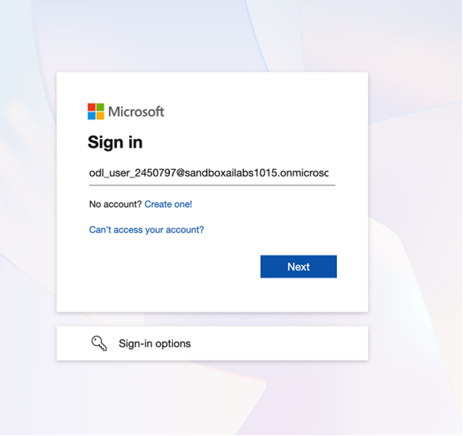

3.  Enter your password.

> 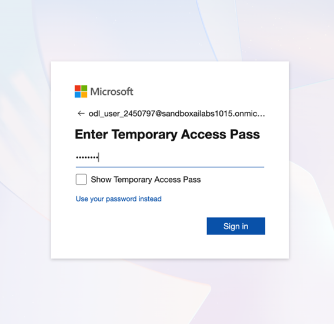

4.  In the +New chat section, select Cowork.

> 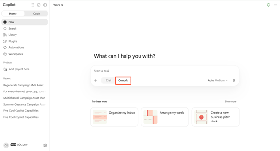

5\. Cowork is now active and ready to use as your calendar assistant for the rest of this lab.

# **Exercise 2: Populate Your Calendar with Sample Expansion Meetings**

Before Cowork can help you manage conflicts and priorities, your calendar needs some real meetings to work with. In this exercise, you’ll use a single prompt to generate a week’s worth of expansion-related meetings — including a few that are deliberately missing agendas, so you can see how Cowork flags that gap later in the lab.

## **Task 1 – Create Sample Meetings Using Copilot Cowork**

In this task, you enter a one-shot prompt that asks Cowork to create eight realistic expansion meetings on your calendar, including two with no agenda so you can test agenda-detection later.

1.  Enter the following prompt in the Cowork prompt field, then select Send:

> Act as my calendar assistant. I am Alex Morgan, Expansion Program
>
> Lead at Zava Retail. We are coordinating the opening of two new
>
> stores next quarter. Please create the following 8 meetings in my
>
> calendar for next week.
>
> Important: For meetings 7 and 8, leave the description and body
>
> completely empty — no agenda text at all.
>
> 1\. "Store Expansion Kickoff — Operations Review"
>
> Monday, 10:00–11:00 AM
>
> Organiser: Tom Bradley (Store Operations Manager)
>
> 2\. "New Store IT Infrastructure Briefing"
>
> Monday, 10:30–11:30 AM
>
> Organiser: IT Team
>
> 3\. "Supplier Onboarding Planning — City Store 1"
>
> Tuesday, 9:00–10:00 AM
>
> Organiser: Lisa Chen (Procurement & Supply Chain Manager)
>
> 4\. "Inventory & Delivery Schedule Review"
>
> Tuesday, 10:00–11:00 AM
>
> Organiser: Lisa Chen (Procurement & Supply Chain Manager)
>
> 5\. "Marketing Campaign Kickoff — Grand Opening"
>
> Tuesday, 11:00 AM–12:00 PM
>
> Organiser: Marketing Team
>
> 6\. "HR Recruitment Drive — Store Staffing Update"
>
> Wednesday, 8:00–9:00 AM
>
> Organiser: HR Team
>
> 7\. "Store Operations Weekly Check-in"
>
> Thursday, 2:00–3:00 PM
>
> Organiser: Tom Bradley (Store Operations Manager)
>
> (NO description, NO agenda — leave body completely blank)
>
> 8\. "Expansion Progress Review — Leadership Update"
>
> Friday, 11:00 AM–12:00 PM
>
> Organiser: Rachel Singh (Operations Director)
>
> (NO description, NO agenda — leave body completely blank)
>
> Please create all 8 meetings and confirm when done.
>
> 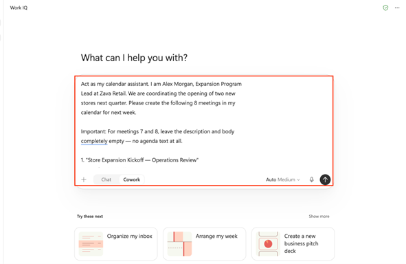

2.  Cowork will ask for your approval before creating each event individually. Select Send to approve each meeting creation request.

> 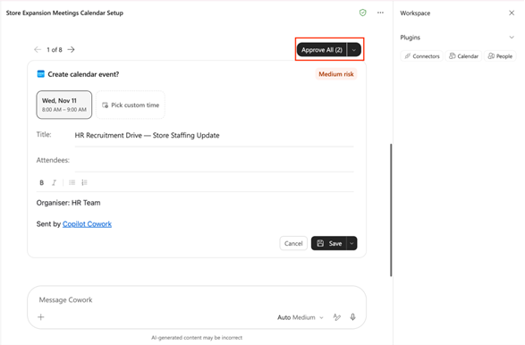
>
> Note: All eight meetings will be created one at a time, and you’ll receive a separate approval prompt for each. Review each request before approving — this is your chance to confirm exactly what Cowork is about to add to your calendar.

## **Task 2: Verify the Meetings**

Confirm that all eight meetings actually landed on your calendar by checking the Teams calendar view.

1.  Open the App Launcher from the left navigation bar and select Teams.

> 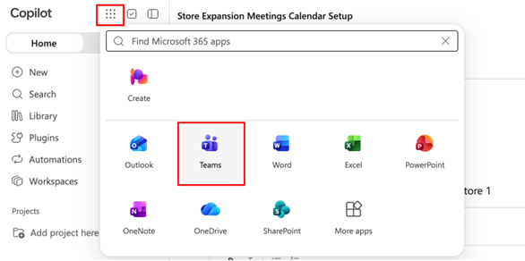

2.  In Teams, select Calendar from the left navigation to view all eight newly created meetings.

> 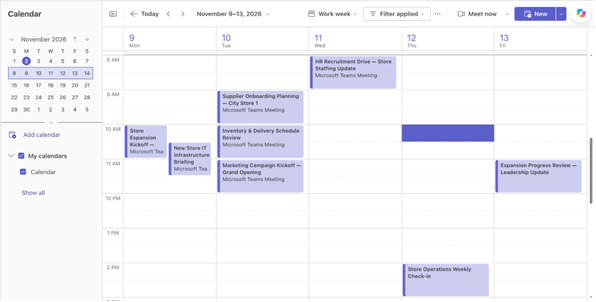

## **Task 3 – Find Meetings by Topic \[NEW · GA · L2-03\]**

1.  In Cowork (or Chat), enter:

> +++Find the meetings on my calendar next week about suppliers or inventory and list the day, time and organiser for each.+++

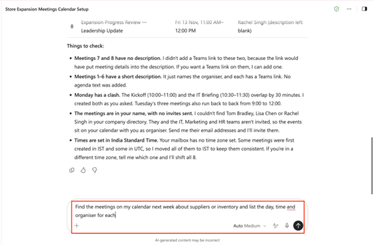

2.  Confirm the Supplier Onboarding Planning and Inventory & Delivery Schedule Review meetings are returned. Note that transcript-based search only covers recent meetings; the sample meetings have no transcripts, so a match on title or body is expected.\[Text Wrapping Break\]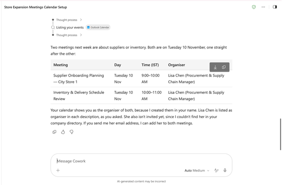

# **Exercise 3: Detect and Resolve Calendar Conflicts**

Use Copilot Cowork to identify overlapping meetings and unbroken meeting runs on your calendar, then apply AI-recommended resolutions with your approval. By the end of this exercise, you’ll have resolved two scheduling conflicts, drafted the related reschedule communications, and reviewed a calendar health summary for the week.

## **Task 1 – Scan the Calendar and Prioritize Conflicts**

Ask Cowork to review the next five business days, flag every overlap and back-to-back run, and propose fixes — while protecting the two meetings Lisa Chen has already confirmed.

1.  Select New Task.\[Text Wrapping Break\]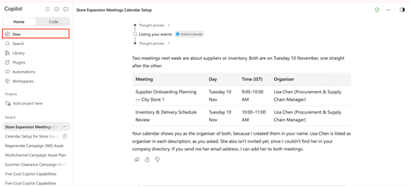

2.  Enter the following prompt and select Send:

> I am Alex Morgan, Expansion Program Lead at Zava Retail. We are
>
> currently coordinating the opening of two new stores in neighbouring
>
> cities next quarter.
>
> Scan my calendar for the next 5 business days and do the following:
>
> 1\. List every scheduling conflict where two or more meetings overlap
>
> 2\. Identify any back-to-back runs of 3 or more consecutive meetings
>
> with no break between them
>
> 3\. For each conflict or back-to-back run, propose a resolution:
>
> — Which meeting should be moved and why
>
> — The best alternative time slot that avoids other meetings
>
> — A polite and professional reschedule message I can send to
>
> the organiser
>
> Priority: Keep the Supplier Onboarding Planning and Inventory &
>
> Delivery Schedule Review meetings in their current slots if possible,
>
> as Lisa Chen has confirmed her availability for those times.
>
> 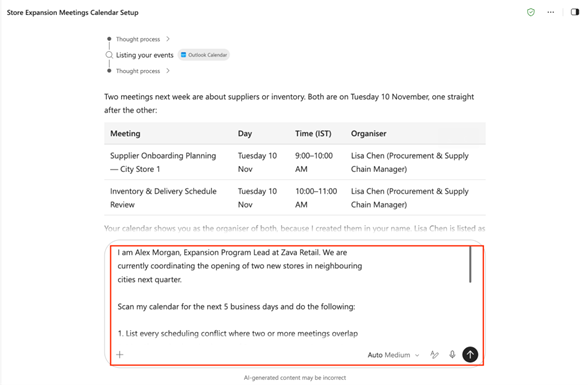
>
> 3\. Cowork returns a full conflict report, including the Monday overlap and the Tuesday back-to-back run, with suggested resolutions for each.
>
> 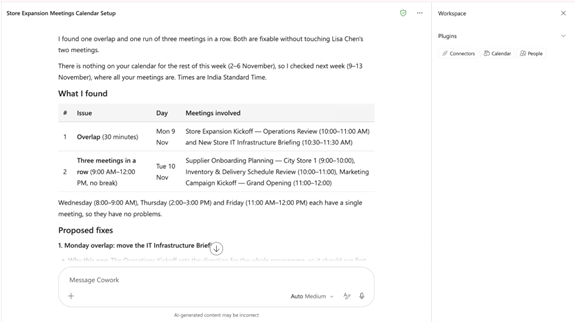

## **Task 2 – Resolve the Monday Conflict**

Act on Cowork’s recommendation for the overlapping Monday meetings: move the IT briefing and draft a reschedule note, without disturbing the higher-priority Operations Review.

1.  With the conflicts identified, ask Cowork to resolve the Monday overlap between the Store Expansion Kickoff and the IT Infrastructure Briefing. Enter the following prompt and select Send:

> For the Monday conflict between the Store Expansion Kickoff —
>
> Operations Review and the New Store IT Infrastructure Briefing,
>
> please do the following:
>
> 1\. Move the IT Infrastructure Briefing to the next available
>
> morning slot this week that does not clash with any other
>
> expansion meetings
>
> 2\. Draft a professional reschedule message to the IT Team explaining
>
> the conflict and proposing the new time
>
> 3\. Keep the tone collaborative — mention that the Store Expansion
>
> Kickoff with Tom Bradley takes priority as it covers operational
>
> readiness for both new store locations
>
> 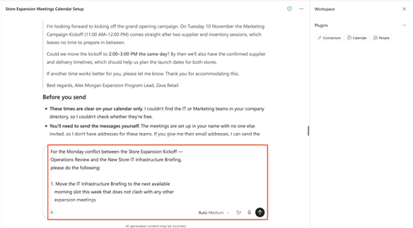

2.  Cowork confirms the new time and shares the drafted reschedule message.

> 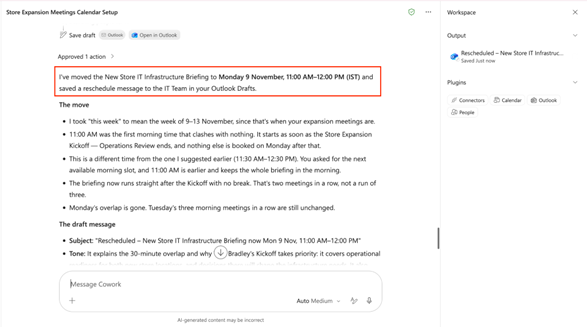

## **Task 3 – Resolve the Tuesday Back-to-Back Run**

Fix the three-meeting Tuesday run by adding prep breaks, keeping Lisa Chen’s confirmed slot untouched, and shifting the Marketing kickoff if needed.

1.  In the same thread, ask Cowork to fix the Tuesday back-to-back run. Enter the following prompt and send:

> For the three back-to-back meetings on Tuesday — Supplier
>
> Onboarding Planning, Inventory & Delivery Schedule Review, and
>
> Marketing Campaign Kickoff — please do the following:
>
> 1\. Keep the Supplier Onboarding Planning at 9:00 AM as Lisa Chen
>
> has confirmed her availability
>
> 2\. Add a 15-minute preparation break between each meeting
>
> 3\. Suggest which meeting is the best candidate to move to a
>
> later slot if a break cannot be inserted without causing
>
> further conflicts
>
> 4\. Draft a brief note to the Marketing Team explaining that
>
> their Campaign Kickoff may need to shift by 30 minutes to
>
> allow preparation time between sessions
>
> 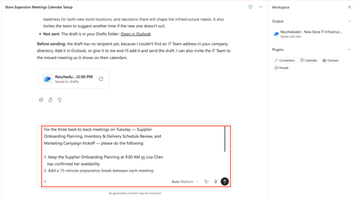
>
> Cowork proposes the adjusted schedule and a draft note to the Marketing Team.
>
> 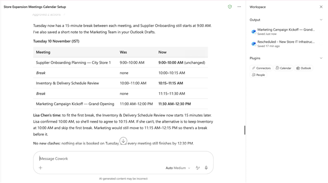

2.  Confirm the changes by entering the following prompt:

> Please apply these schedule changes to the calendar. Then create the
>
> email as a draft in Outlook — don’t send it — so I can review it
>
> first.

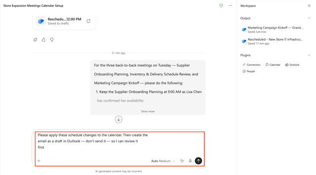

3.  Select Update to apply the changes to the calendar.

> Cowork confirms the calendar has been updated and the email has been saved as a draft.
>
> 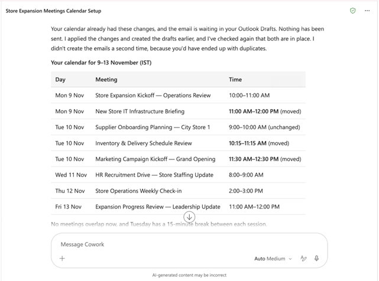

4.  To review the draft email, open the App Launcher and select Outlook (or use the direct draft link Cowork provides).

> 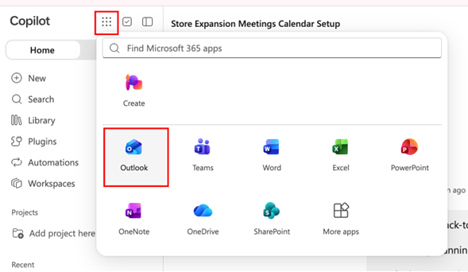
>
> *\[Original screenshot – paste back as is: ./media/image32.png\]*

5.  Review the draft email.

> 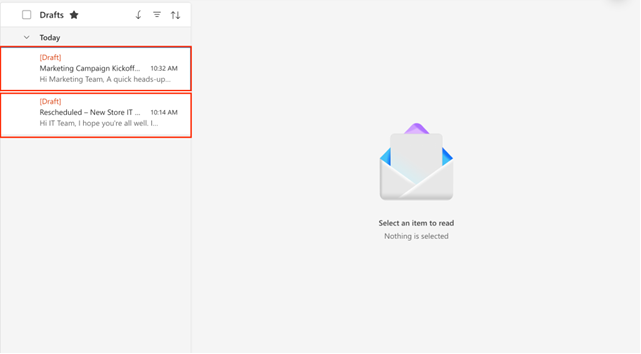

## **Task 4 – Get a Calendar Health Summary**

Wrap up the exercise with an at-a-glance summary of meeting load for the week, plus a recommendation for when to block time for the Master Expansion Plan.

1.  Request a summary of the week’s calendar health. Paste the following prompt:

> +++Now give me a Calendar Health summary for this week’s expansion
>
> meetings. Include:
>
> 1\. Total number of meetings and total meeting hours this week
>
> 2\. Any days that are overloaded with meetings
>
> 3\. Days that have good availability for focused strategic work
>
> 4\. One recommendation for when I should block time to work on
>
> the Master Expansion Plan document — considering all the
>
> meetings we have just resolved
>
> Keep the summary concise and actionable.+++

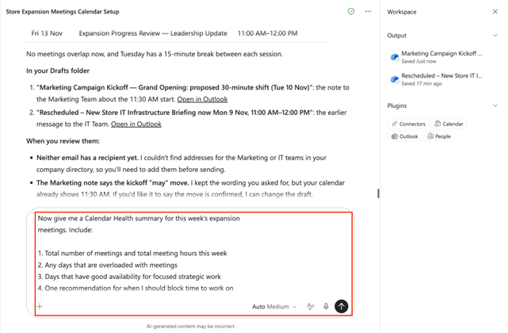

> 2\. Cowork returns a concise summary of meeting load, overloaded days, and a recommended time to block for focused work.
>
> 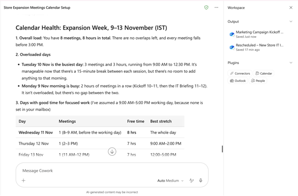

## **Task 5 – Triage the Reschedule Emails in Outlook (optional) \[NEW · GA · L2-05\]**

1.  In Cowork (or Copilot in Outlook), enter:

> +++Find the reschedule emails and drafts from this week about the expansion meetings. Categorise them as Expansion - Calendar, create a folder called Expansion Reschedules, and move them there. Ask me before making any change.+++

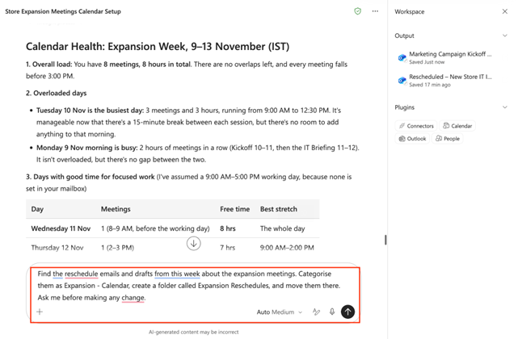

2.  Confirm Copilot lists the affected emails and asks for confirmation. Copilot is expected to confirm before acting on more than five emails or changing rules, so with fewer matching emails the folder or rule request is the part to verify.

> 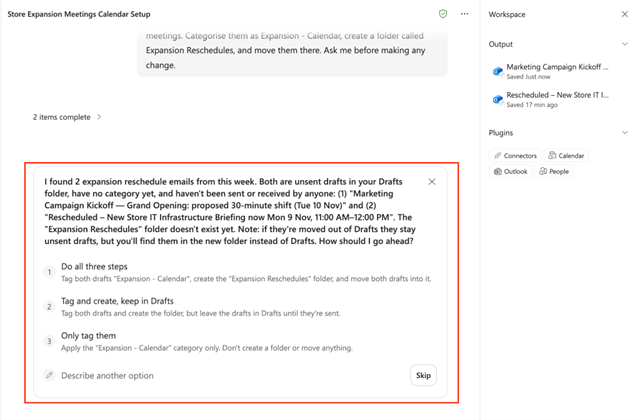

3.  Approve, then confirm the category and folder appear in Outlook.

> 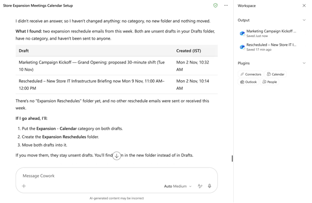

# **Exercise 4: Schedule Meetings Intelligently Using Email Context**

Real scheduling requests rarely come with a full brief attached — often the context lives in an email thread. In this exercise, you’ll send yourself a sample email about supplier onboarding, then ask Cowork to use that context to intelligently schedule a recurring sync with Lisa Chen, complete with a Teams link and a draft agenda.

## **Task 1 – Send a Sample Context Email**

Send yourself a short email about supplier onboarding so Cowork has real context to draw on when it drafts the meeting agenda.

1.  Navigate to C:\Lab Files\Cowork folder and open the coworkSampleEmail file get the sample email for this lab.

2.  Send a sample email about supplier onboarding to the current user using your personal email address.

> 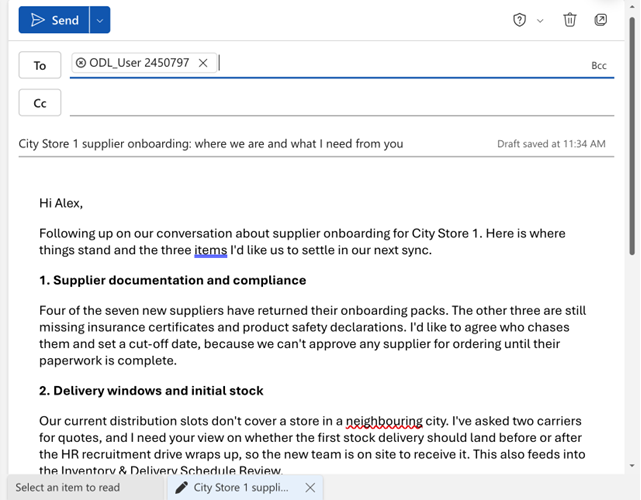

3.  Verify the email has arrived in your inbox.

> 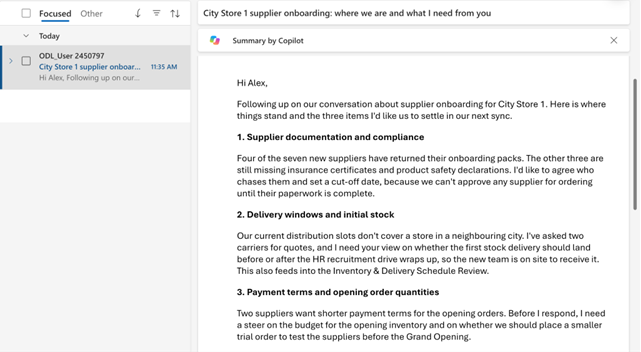

## **Task 2 – Schedule the Weekly Project Sync**

Ask Cowork to book a 30-minute sync with Lisa Chen, applying scheduling constraints and pulling talking points straight from the email you just sent.

1.  Select New task.

2.  Enter the following prompt and select Send:

> Schedule a 30-minute 'Weekly Project Sync' with Lisa Chen next week.
>
> Constraints: not Monday, not within 30 minutes of either of our
>
> existing meetings, prefer mornings, and add a Teams link and a draft
>
> agenda with 3 talking points based on our recent email thread about
>
> supplier onboarding.
>
> 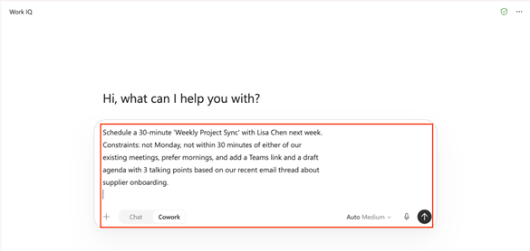
>
> Cowork reviews the supplier onboarding email you sent to build the agenda talking points.

3.  When prompted, confirm that Cowork should send the meeting invite.

> 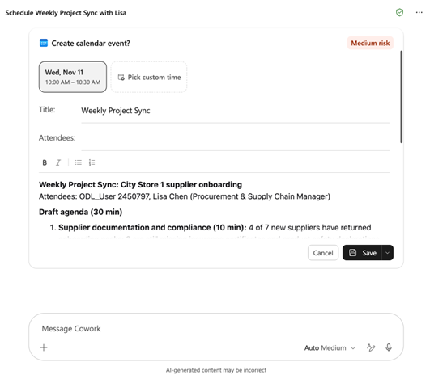

4.  Open the Teams calendar to verify the Weekly Project Sync was created.

5.  Check the personal email address you used earlier — you should receive a meeting request for the newly scheduled sync.\[Text Wrapping Break\]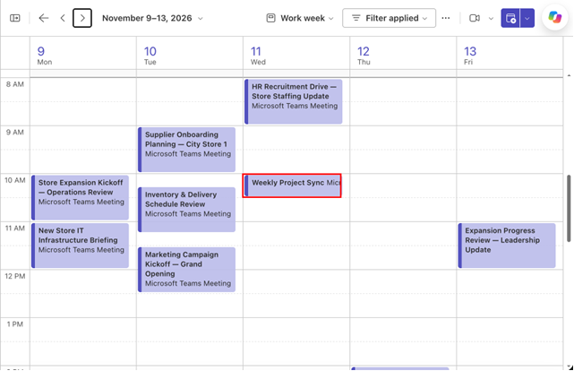

## **Task 3 – Save the Approach as a Reusable Skill \[NEW · GA · L2-06\]**

1.  In the same thread, enter:

> +++Save what you just did as a reusable skill called Weekly sync scheduler: schedule a 30-minute recurring sync with a named person using my constraints, add a Teams link, and draft an agenda from recent email threads on the topic.+++

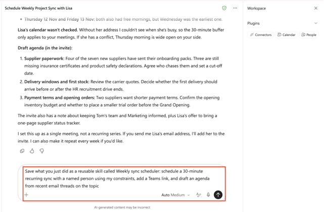

2.  Select Approve to approve the skill.

> 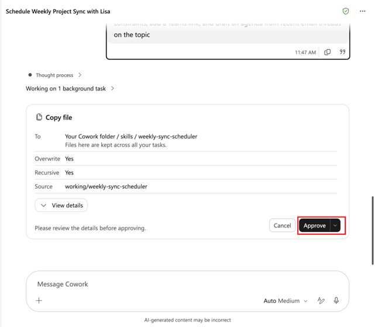

3.  Open the skill’s menu and look at Share. Leave the audience as Only you; do not share it with colleagues in the lab tenant.

> 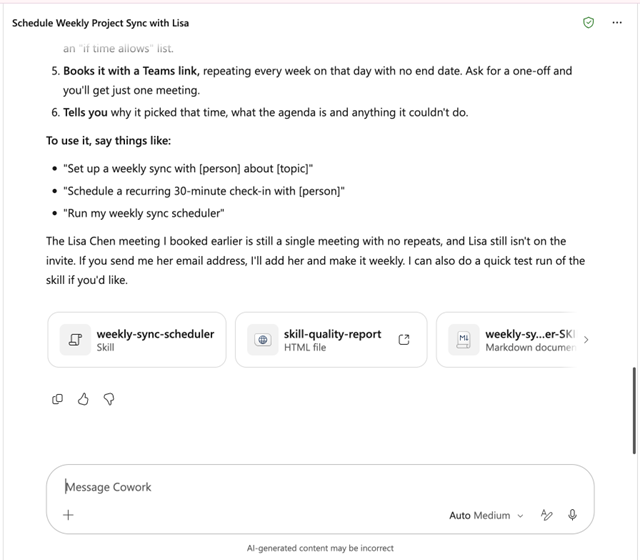

# **Exercise 5: Apply Executive Calendar Management Rules**

In this exercise, you’ll move from one-off fixes to standing rules — the kind of protections a real executive assistant would maintain automatically. You’ll set up a minimum-notice rule and a protected daily focus block, test the notice rule against a real short-notice request, and finish with an executive summary confirming everything is on track.

## **Task 1 – Define Standing Calendar Rules**

Set up two ongoing rules: flag any meeting requested with less than 48 hours’ notice, and protect a 90-minute daily focus block for the Master Expansion Plan.

1.  Select New task.

> 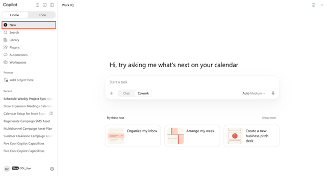

2.  Enter the following prompt in the prompt field and click the Send button to execute the prompt:

> I want to apply two standing rules to my calendar going forward: (1)
>
> Any meeting requested with less than 48 hours’ notice should be
>
> flagged, and I should be prompted before accepting — this is Rachel
>
> Singh’s requirement as Operations Director. (2) Protect a daily
>
> 90-minute focus block each morning this week for the Master Expansion
>
> Plan document — no meetings should be scheduled over it without my
>
> explicit approval. Show me what this looks like on my calendar before
>
> making any changes.
>
> 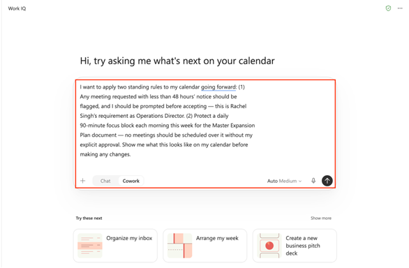
>
> Cowork walks you through how it plans to apply both rules before touching your calendar.
>
> Note: Cowork’s responses are AI-generated, so exact wording may vary from what’s shown here.

3.  Review each clarifying prompt Cowork presents as it works through the setup.

> 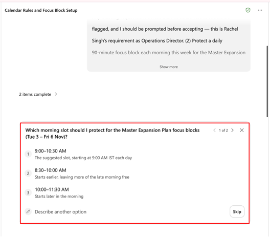

4.  Cowork will show you how the focus blocks look on your calendar across the week. Click Send.

5.  Select Schedule to confirm the recurring focus block task.

> 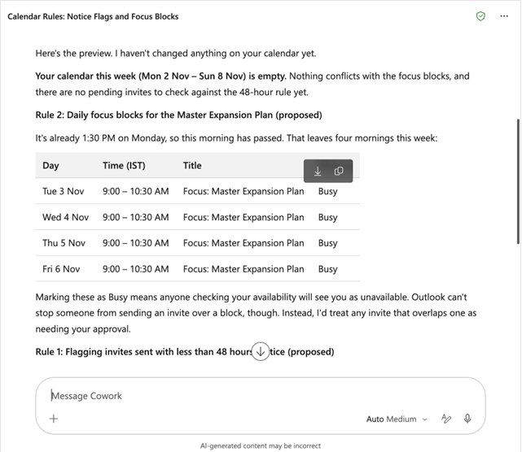

6.  Cowork confirms both standing rules — the 48-hour notice flag and the protected focus blocks — are now active.

## **Task 2 – Test the 48-Hour Notice Rule**

Simulate a real short-notice request from Tom Bradley to confirm the new notice rule actually triggers as expected.

1.  Enter the following prompt to test the rule you just created, then select Send:

> Tom Bradley just messaged asking for a 30-minute call tomorrow morning
>
> to discuss a staffing issue at City Store 1 — no agenda given. Can you
>
> find time? Tom’s email address is: <xyz@abc.com>
>
> 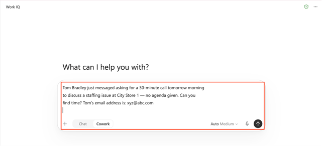

2.  Cowork flags the request as short-notice and asks for your permission before proceeding.

> 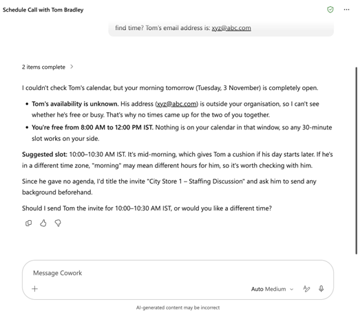

3.  Review and approve the proposed meeting slot when prompted.

> 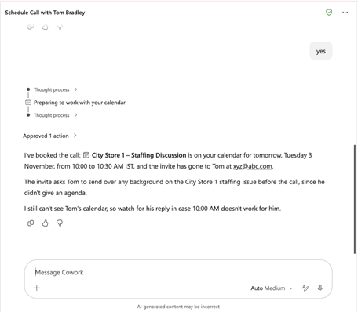

## **Task 3 – Get an Executive Summary**

As Expansion Program Lead, Alex needs a final status check before facing Rachel Singh on Friday. Ask Cowork to confirm focus time is protected, flag any meetings still missing an agenda, and verify Alex is on track for the Leadership Update.

1.  Enter the following prompt in the prompt field and click the Send button to execute the prompt:

> Give me an executive summary of my calendar for the rest of this week:
>
> confirm my focus blocks are protected, flag any meetings that still
>
> don’t have an agenda, and tell me if I’m on track to have
>
> uninterrupted time to finish the Master Expansion Plan before Friday’s
>
> Leadership Update with Rachel Singh.
>
> 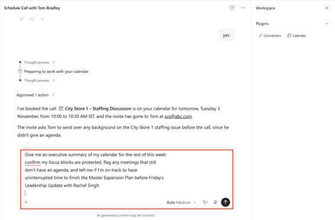
>
> 2\. Cowork returns an executive summary confirming your protected focus time, any meetings still missing an agenda, and whether you’re on track for Friday’s Leadership Update.
>
> 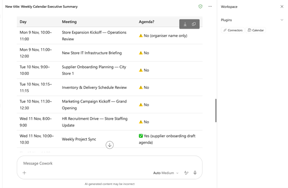
>
> **3.** If the response shows memory citations (an indication of what personalised the answer), note what they reference. This is a small October 2026 addition and may not appear in every tenant.
>
> 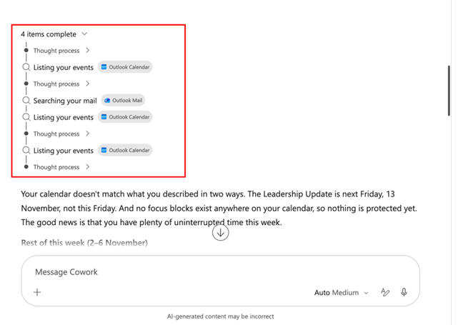

## **Task 4 – Automate the Weekly Conflict Scan \[NEW · GA · L2-08\]**

1.  Select New task and enter:

> +++Every Monday at 8:00 AM, scan my calendar for the next 5 business days for overlapping meetings and back-to-back runs of 3 or more meetings, and draft (do not send) reschedule notes for anything you find.+++

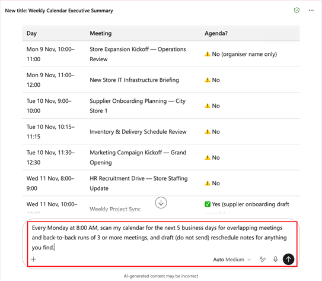

2.  When Cowork proposes a schedule, confirm it.

> 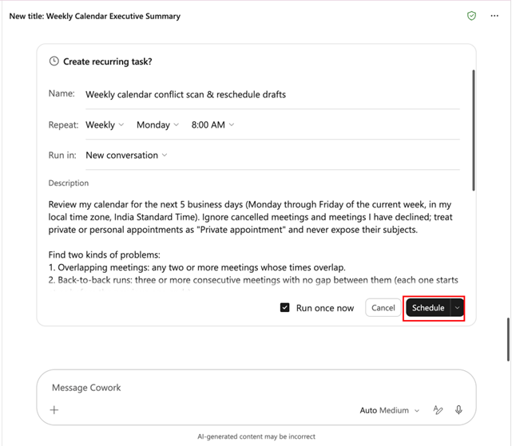

3.  Open Automations (in the Home navigation pane, or on the Customize page) and confirm the automation is listed. Use the run-now option if offered to test it once.

> 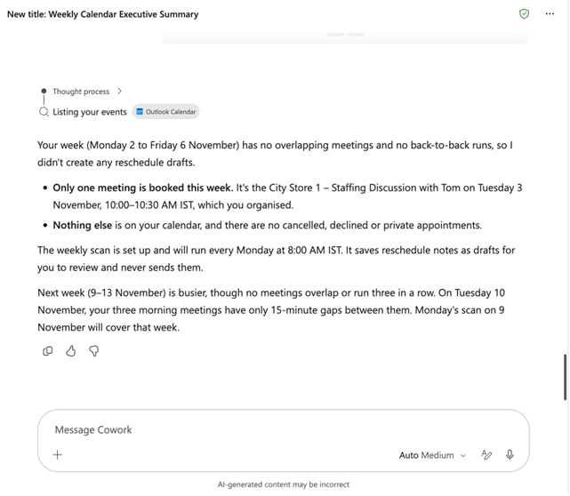

4.  Cleanup: delete the automation when you finish, because scheduled runs consume Copilot Credits.

## **Exercise 6: Estimate Copilot Credit Use for Cowork**

Before rolling Cowork out to the expansion team, Zava Retail IT wants a directional estimate of the monthly Copilot Credit spend. In this exercise, you’ll sort the prompts you ran in this lab into light, medium and heavy, then use the Cowork cost estimator to model one user and a small team.

**Note:** The estimator gives a directional view only. It is an unofficial web recreation of Microsoft’s Customer Cowork Estimator spreadsheet and assumes a specific model, so validate any figures against your own usage before budgeting.

### Task 1 – Classify the Prompts You Ran

Sort the prompts from this lab into the three categories the estimator uses, so you have real numbers to enter.

1.  Use these definitions:

    - **Light:** narrow context, 0–1 tool calls, minimal runtime, 0–1 deliverables.

    - **Medium:** richer context, several tool calls, moderate runtime, 2 or more outputs.

    - **Heavy:** broad context aggregation, many tool calls, sustained runtime, many outputs.

2.  Review the prompts you ran in Exercises 2 to 5 and classify each one. Use the suggested classes below as a starting point:

<!-- -->

3.  

<table>
<colgroup>
<col style="width: 61%" />
<col style="width: 38%" />
</colgroup>
<tbody>
<tr class="odd">
<td><blockquote>

<strong>Prompt</strong>

</blockquote></td>
<td><blockquote>

<strong>Suggested class</strong>

</blockquote></td>
</tr>
<tr class="even">
<td><blockquote>

Exercise 2: create 8 meetings

</blockquote></td>
<td><blockquote>

Heavy

</blockquote></td>
</tr>
<tr class="odd">
<td><blockquote>

Exercise 2, Task 3: find meetings by topic

</blockquote></td>
<td><blockquote>

Light

</blockquote></td>
</tr>
<tr class="even">
<td><blockquote>

Exercise 3, Task 1: conflict scan

</blockquote></td>
<td><blockquote>

Heavy

</blockquote></td>
</tr>
<tr class="odd">
<td><blockquote>

Exercise 3, Tasks 2 and 3: Monday fix, Tuesday fix, apply changes and draft email

</blockquote></td>
<td><blockquote>

Medium

</blockquote></td>
</tr>
<tr class="even">
<td><blockquote>

Exercise 3, Task 4: calendar health summary

</blockquote></td>
<td><blockquote>

Medium

</blockquote></td>
</tr>
<tr class="odd">
<td><blockquote>

Exercise 4, Task 2: Weekly Project Sync

</blockquote></td>
<td><blockquote>

Medium

</blockquote></td>
</tr>
<tr class="even">
<td><blockquote>

Exercise 4, Task 3: save a skill

</blockquote></td>
<td><blockquote>

Light

</blockquote></td>
</tr>
<tr class="odd">
<td><blockquote>

Exercise 5, Tasks 1 to 3: standing rules, notice-rule test, executive summary

</blockquote></td>
<td><blockquote>

Medium

</blockquote></td>
</tr>
<tr class="even">
<td><blockquote>

Exercise 5, Task 4: weekly conflict scan automation

</blockquote></td>
<td><blockquote>

Light to set up, Medium for each scheduled run

</blockquote></td>
</tr>
</tbody>
</table>

4.  Count your prompts and write down the totals: \_3\_\_ light, \_4\_\_ medium, \_2\_\_ heavy.

Note: The suggested classes are a guide. If a prompt behaved differently in your tenant, classify it by what you observed and record why.

### Task 2 – Model One User

Enter your lab totals into the estimator to see what one learner’s session costs.

1.  Open a web browser and navigate to +++[<u>https://coworkestimator.com/+++</u>](https://coworkestimator.com/+++).\[Text Wrapping Break\]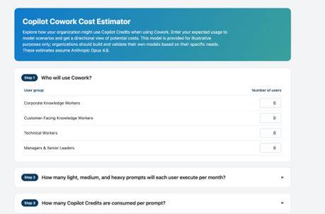

2.  In **Step 1 – Who will use Cowork?**, enter **1** in **Managers & Senior Leaders** (Alex Morgan’s role). Leave the other groups empty.\[Text Wrapping Break\]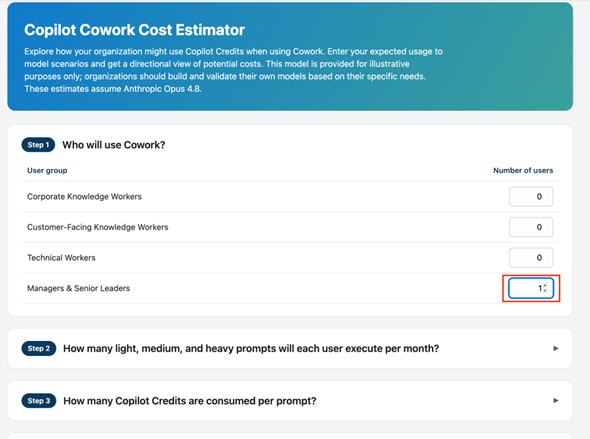

3.  Expand **Step 2** and enter your Task 1 totals for the Managers & Senior Leaders row.

> 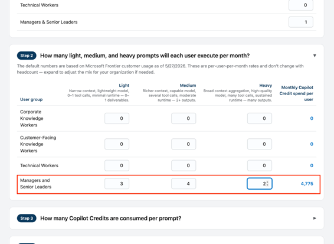

4.  Expand **Step 3** and record the default Copilot Credits per light, medium and heavy prompt.

> 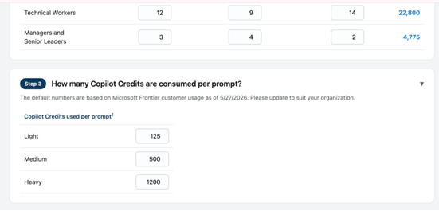

5.  In **Step 4 – Summary**, record the **Est. monthly Copilot Credits** and the **Average price per user per month**.

> 

\[Screenshot placeholder: estimator Step 1 to Step 4 with one Managers & Senior Leaders user\]

# **Summary**

In this lab, you used Microsoft 365 Copilot Cowork as an AI-powered executive assistant to manage Alex Morgan’s calendar during a store expansion program — detecting and resolving scheduling conflicts, scheduling a meeting using email context, and setting up standing rules to protect focus time, all with your approval at each step. Optionally, you saved a reusable skill, automated a recurring scan and reviewed credit use.

By the end of this lab, you should be able to:

- Detect and resolve calendar conflicts using natural-language prompts

- Schedule meetings that respect business constraints and stakeholder context

- Set up standing rules to protect focus time and enforce notice requirements

- Review and approve AI-generated calendar and email actions before they’re applied

- (Optional) Save repeatable work as a skill and automate it on a schedule
