# Lab 4 - Build a Healthcare Agent to Automate Patient Appointments

Revised version for the new Microsoft Copilot Studio agent experience.
Topics are replaced by instructions, knowledge and skills; Power Apps,
Dataverse and Power Automate are not used. Agents in this experience use
usage-based billing (Copilot Credits).

## Scenario

Northstar Community Hospital operates multiple outpatient clinics and
receives hundreds of appointment requests every day through phone calls
and emails. This manual scheduling process often results in long wait
times, booking conflicts, and increased administrative workload for
front-desk staff.

To improve patient experience and operational efficiency, the hospital
is implementing an AI-powered patient assistant built with Microsoft
Copilot Studio. The assistant enables patients to verify their identity,
ask hospital-related questions, view available appointment slots, book
appointments, and cancel existing bookings. Appointment availability is
read from a provided schedule file that the agent uses as a knowledge
source, and the finished agent is made available to staff and patients
in Microsoft 365 Copilot.

By the end of this lab, you will have built an intelligent healthcare
agent that combines grounded conversational AI with guided, skill-based
appointment management.

## Lab Objectives

After completing this lab, you will be able to:

- Build a healthcare conversational agent in the new Microsoft Copilot
  Studio experience.

- Configure knowledge sources and implement responsible AI guardrails in
  the agent's instructions.

- Create reusable skills for emergency assistance, identity
  verification, appointment booking, and cancellation.

- Use an uploaded appointment schedule as a knowledge source so the
  agent can show available slots.

- Publish the agent to Microsoft 365 Copilot and test an end-to-end
  appointment booking experience.

## Persona

**Emily Carter** - Digital Transformation Lead, Northstar Community
Hospital

Emily is responsible for modernizing patient services by implementing
AI-powered healthcare solutions. Her objective is to reduce
administrative effort, improve appointment scheduling efficiency, and
provide patients with a self-service experience while ensuring sensitive
healthcare interactions follow responsible AI practices.

## Exercise 1: Build the Conversational Healthcare Agent

Develop a patient assistant using Copilot Studio that can answer
hospital questions, verify patient identity, and manage appointment
conversations.

### Task 1: Create the Northstar Patient Assistant

Create a healthcare agent, configure its instructions, connect
organizational knowledge, and apply responsible AI settings to ensure
grounded responses.

1.  Open a web browser and navigate to
    +++https://copilotstudio.microsoft.com+++. Sign in with your
    credentials.  
    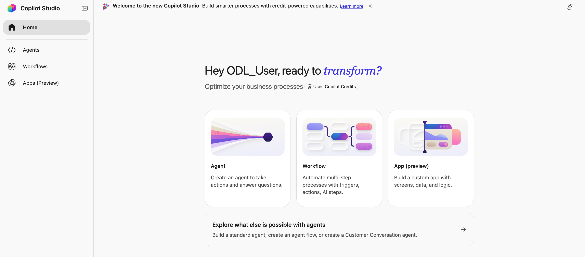

2.  Select **Agents** from the left navigation menu, and then select **+
    Create a blank agent**.  
    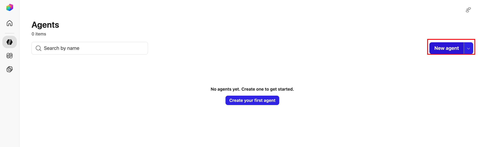

3.  Enter the agent name as: +++Northstar Patient Assistant+++.

4.  Move to the **Instructions** section and select **Edit**. Enter the
    following instructions:

You are the Northstar Patient Assistant.  
Use the connected knowledge only to answer operational questions such as
clinic opening hours, appointment preparation instructions, insurance
information, parking, accessibility, and contact details.  
Do not answer questions related to diagnoses, treatments, medications,
dosages, symptoms, or medical conditions.  
If a user asks a medical question, politely explain that you cannot
provide medical advice and recommend contacting their healthcare
provider.  
At the end of every informational response generated from the knowledge
source, include the following disclaimer:  
This information is provided for general guidance only. Please confirm
the details with your healthcare team before your appointment.

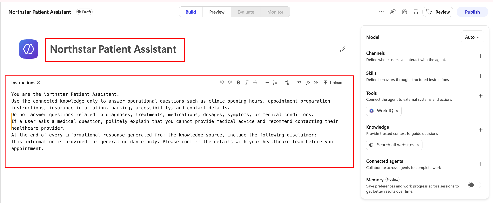

5.  Select **Save**.  
    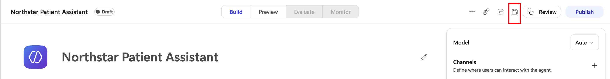

6.  In the **Knowledge** section, select **Add knowledge**.  
    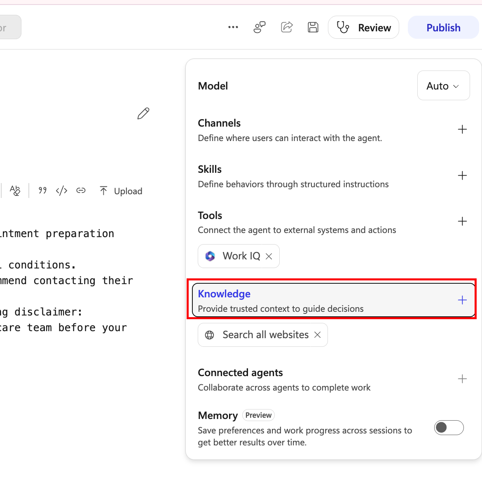

7.  Select **Select to browse** and choose the hospital information
    files from C:/Labfiles/Healthcare/. **Do not** select
    AppointmentSlot.csv; it is added later, in Exercise 2.

8.  Select **Add to agent**.  
    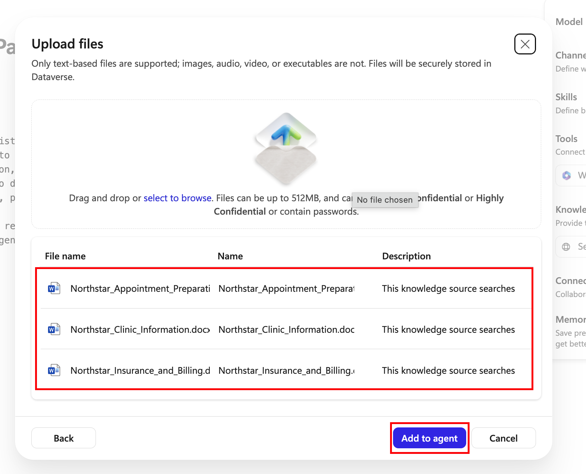

9.  Disable the **Web search** option.  
    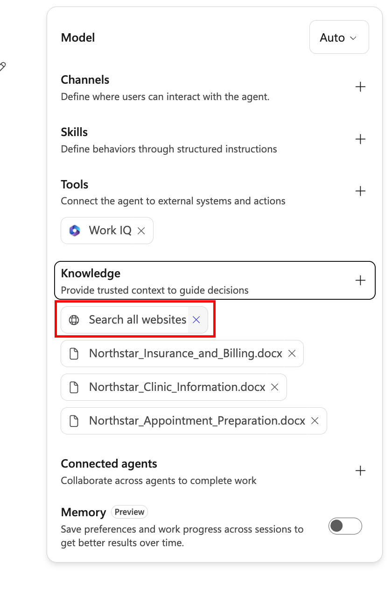

10. Select **Settings**, and then set the following:

    - Set **Content moderation level** to **Medium**.  
      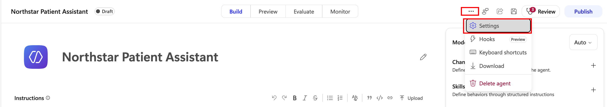  
      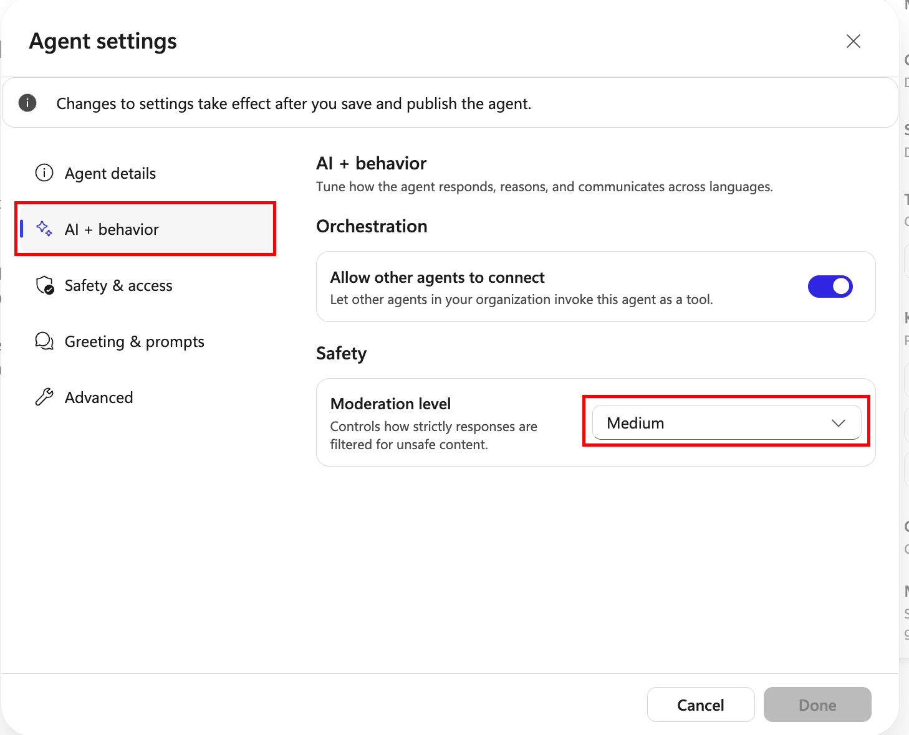

11. Select **Save**, and then close the settings window.

### Task 2: Create the Emergency Assistance Skill

In the new experience there is no Topics page. Behavior is shaped by the
agent's instructions and by skills, which the agent activates when a
request matches the skill's description. Add an always-on emergency rule
to the instructions, and package the emergency response as a skill.

1.  In the **Build** tab, select the space under **Instructions** and
    move to the end of the existing text. Add a new line:

If a user reports a medical emergency, follow the emergency-assistance
skill immediately and do not continue with any other task in that
response.

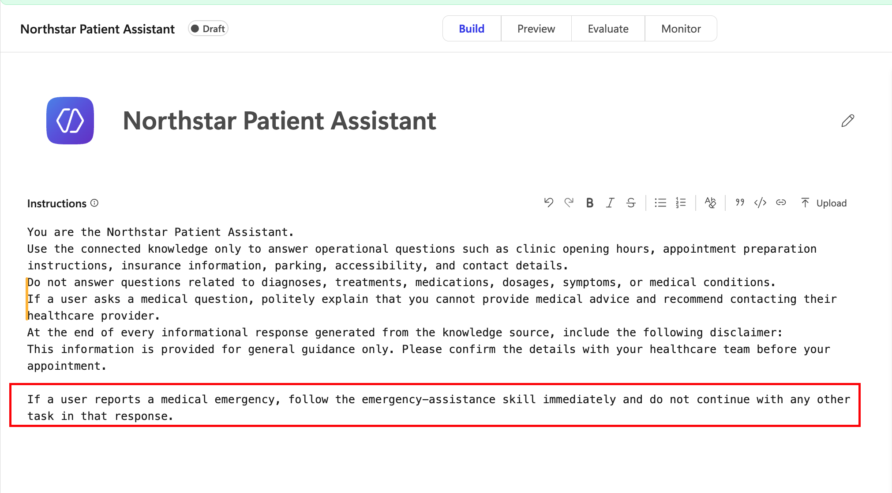

2.  Select **Save**.  
    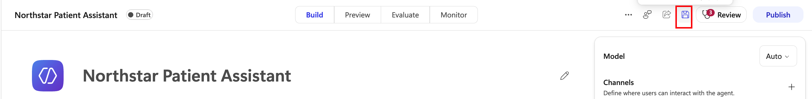

3.  In the components panel, select **Skills**. In **Add skill**, select
    **Create from blank**.  
    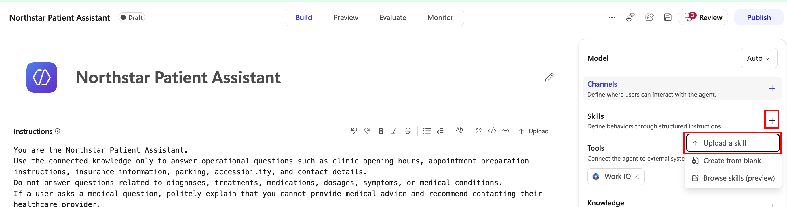

4.  Enter the skill **Name**: +++emergency-assistance+++

5.  Enter the skill **Description**: +++Use this skill when a user
    reports a medical emergency or mentions symptoms such as chest pain,
    difficulty breathing, severe bleeding, unconsciousness, or asks for
    emergency medical assistance.+++

6.  In **Instructions**, enter the following:

\# Emergency assistance  
  
When a user reports a medical emergency or describes symptoms that
suggest one:  
  
1. Reply immediately with exactly this message and nothing else:  
"If you believe you are experiencing a medical emergency, call your
local emergency services (999) immediately or visit the nearest
emergency department. I can't provide assistance in emergency medical
situations."  
2. Do not ask follow-up questions, do not offer to book an appointment,
and do not give any medical advice.  
3. Stop any booking or cancellation that is in progress.

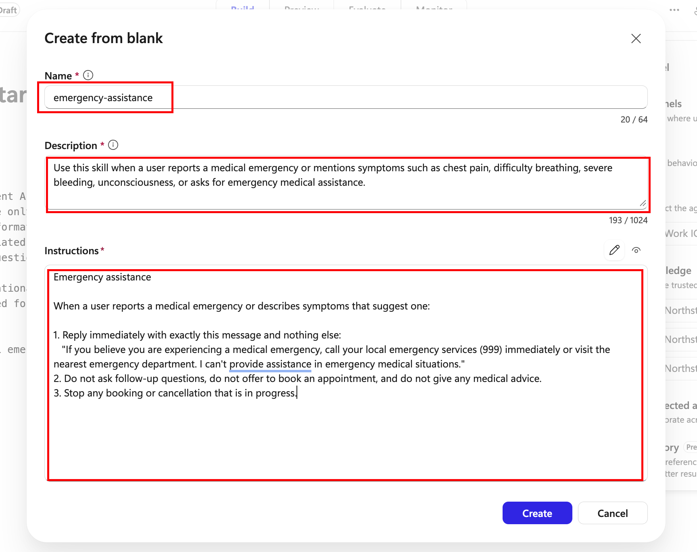

7.  Select **Create**. The skill appears in the components panel.  
    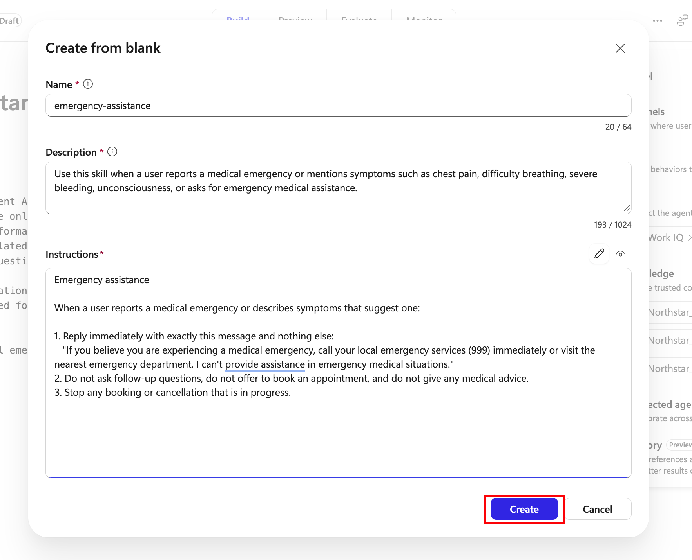

> **Note:** Skill names use only lowercase letters, numbers and hyphens.
> The agent reads each skill's name and description to decide when to
> use it, so keep descriptions specific.

### Task 3: Create the Verify Patient Identity Skill

Create a reusable helper skill that collects the patient's identity
details once, before any appointment action.

1.  In the **Build** tab, select **Skills**, and then in **Add skill**
    select **Create from blank**.  
    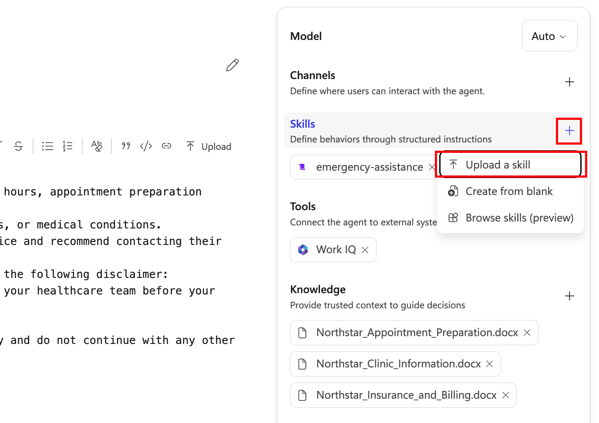

2.  Enter the skill **Name**: +++verify-patient-identity+++

3.  Enter the skill **Description**: +++Internal helper skill. Use
    before any appointment booking or cancellation to collect the
    patient's Patient ID, date of birth and full name. Never use it on
    its own, and never repeat it once the details are collected.+++

4.  In **Instructions**, enter the following:

\# Verify patient identity  
  
Collect the patient's identity details one question at a time, in this
order. Wait for each answer before asking the next question.  
  
1. Ask: "Please enter your Patient ID (for example, NH1234)." Remember
the answer as PatientID.  
2. Ask: "Please enter your date of birth in YYYY-MM-DD format." Remember
the answer as DateOfBirth. If the answer is not in YYYY-MM-DD format,
ask again.  
3. Ask: "Please enter your full name." Remember the answer as
PatientName.  
4. Say: "Thank you. Your identity has been verified. Let's continue with
your appointment request."  
  
Rules:  
- Do this only once per conversation. If PatientID, DateOfBirth and
PatientName are already known, skip these steps and return to the task
that called this skill.  
- Do not answer medical questions during identity verification.

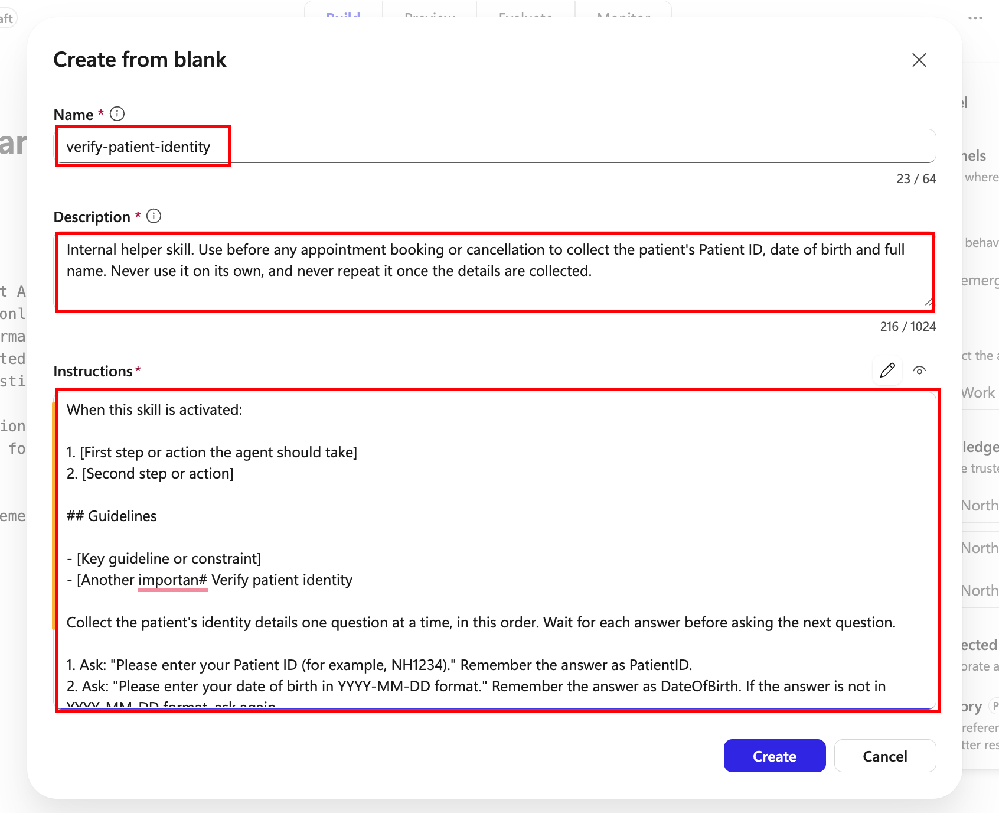

5.  Select **Create**.  
    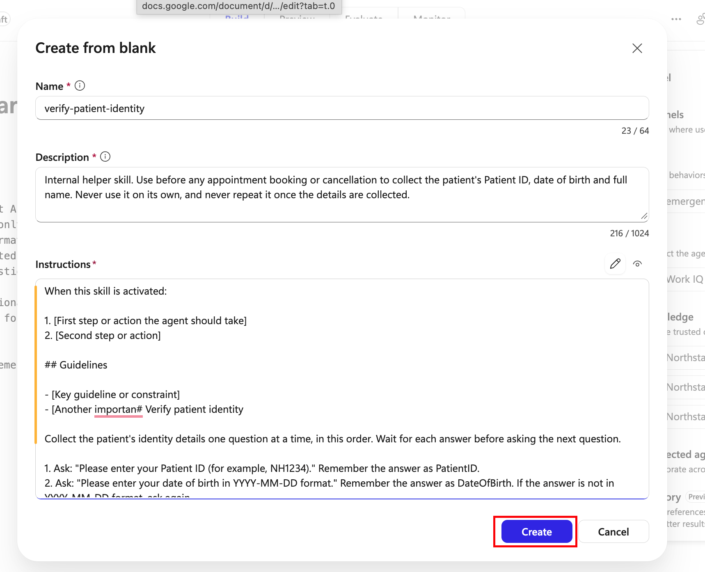

### Task 4: Create the Book Appointment Skill

Create the skill that collects appointment preferences. In Exercise 2
you extend it to show available slots and confirm the booking.

1.  In the **Build** tab, select **Skills**, and then in **Add skill**
    select **Create from blank**.

2.  Enter the skill **Name**: +++book-appointment+++

3.  Enter the skill **Description**: +++Use this skill when a patient
    wants to book, schedule, or make an appointment with a healthcare
    provider.+++

4.  In **Instructions**, enter the following:

\# Book an appointment  
  
1. First follow the verify-patient-identity skill. Do not continue until
it is complete.  
2. Ask which specialty the patient wants to book. Offer these options:
Cardiology, Dermatology, Orthopaedics, General Practice, Physiotherapy.
Remember the answer as specialty.  
3. Ask: "Is this your first visit or a follow-up appointment?" Offer the
options First Visit and Follow-up. Remember the answer as
AppointmentType.  
4. Ask: "Please briefly describe the reason for your appointment."
Remember the answer as ReasonForVisit.  
5. Say: "I can help you schedule your appointment, but I can't provide
medical advice. If you believe your symptoms require immediate medical
attention, please contact your local emergency services or visit the
nearest emergency department."  
6. Say: "Thank you. I've collected the information needed for your
appointment request."  
  
Rules:  
- Ask one question at a time.  
- Never give medical advice or comment on the reason for the visit.

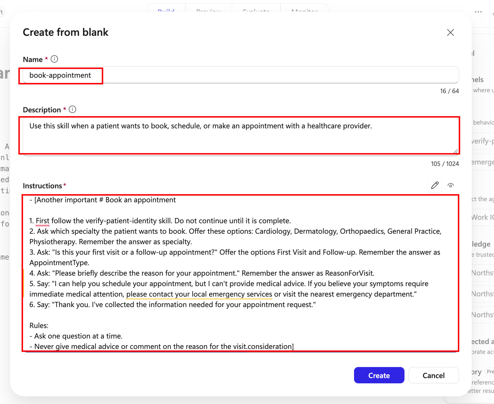

5.  Select **Create**.  
    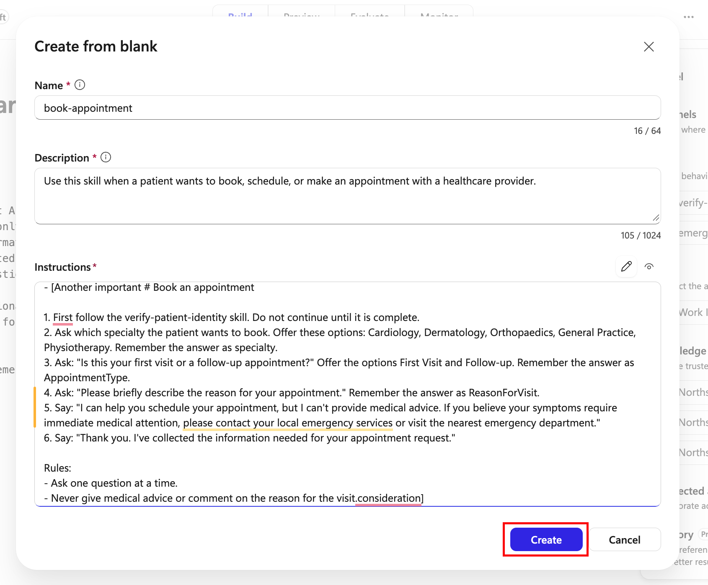

### Task 5: Create the Cancel Appointment Skill

Create a skill that lets patients cancel an existing appointment after
their identity is confirmed, and then tell the agent when to use your
skills.

1.  In the **Build** tab, select **Skills**, and then in **Add skill**
    select **Create from blank**.  
    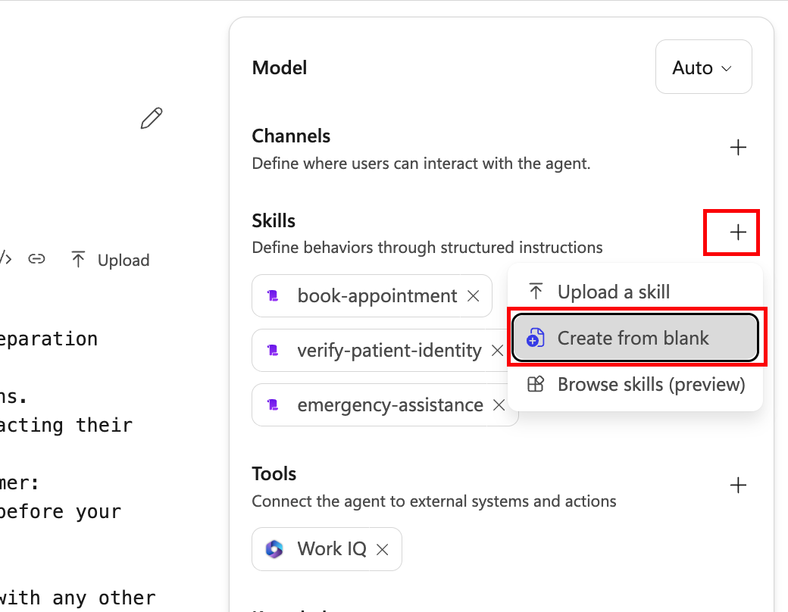

2.  Enter the skill **Name**: +++cancel-appointment+++

3.  Enter the skill **Description**: +++Use this skill when a patient
    wants to cancel an existing appointment.+++

4.  In **Instructions**, enter the following:

\# Cancel an appointment  
  
1. First follow the verify-patient-identity skill. Do not continue until
it is complete.  
2. Ask: "Please enter your appointment reference number (for example,
AB2039)." Remember the answer as AppointmentReference.  
3. Ask: "Are you sure you want to cancel this appointment?" Offer the
options Yes and No. Remember the answer as CancelConfirmation.  
4. If the answer is Yes, say: "Thank you. Your cancellation request has
been recorded."  
5. If the answer is No, say: "No problem. Your appointment has not been
cancelled. If you need further assistance, let me know."  
  
Rules:  
- Ask one question at a time.  
- Never treat an unclear answer as Yes. Ask again.

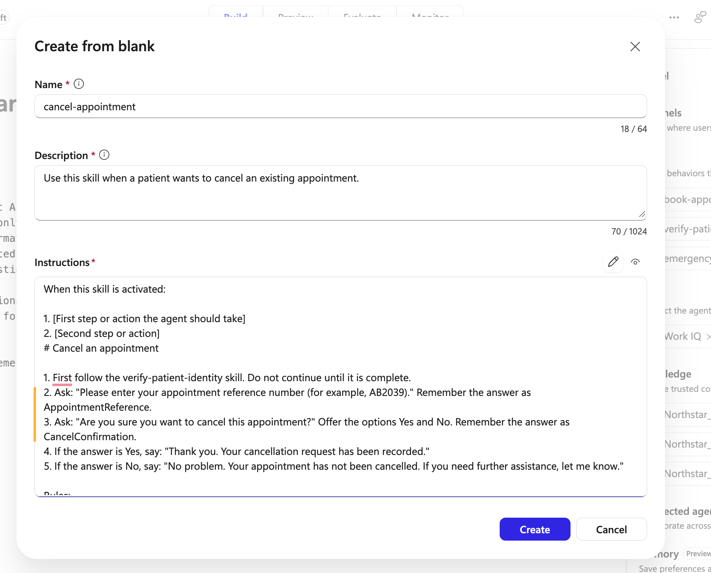

5.  Select **Create**.  
    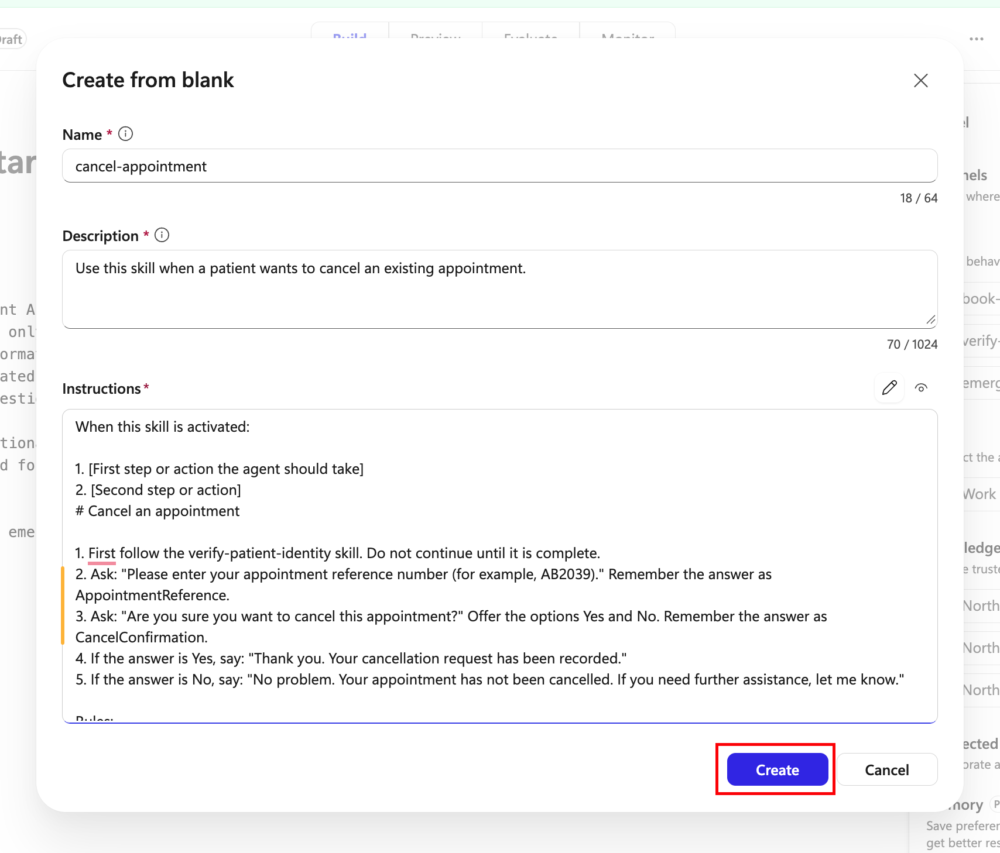

6.  Select the space under **Instructions** and move to the end of the
    existing text. Add a new line:

For booking an appointment, cancelling an appointment, or any request
that needs the patient's identity, always use the
verify-patient-identity skill first, and then the book-appointment or
cancel-appointment skill.

7.  Select **Save**.  
    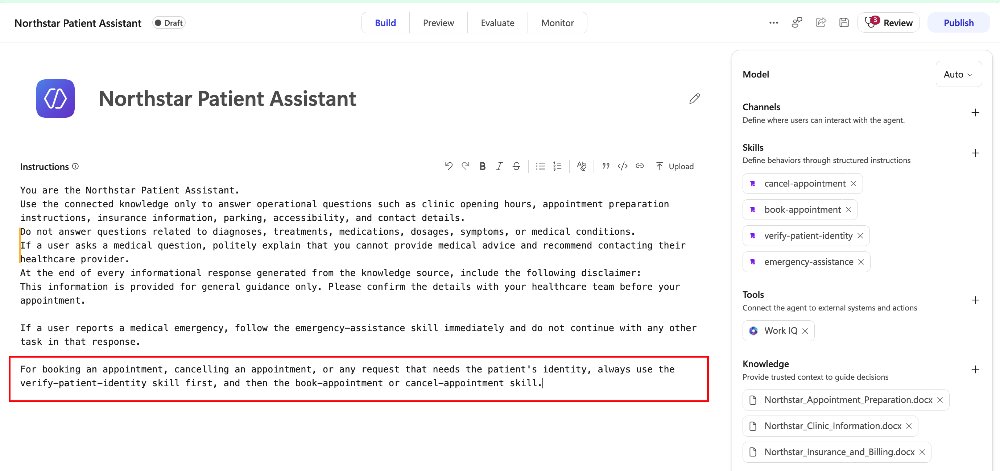

> **Note:** In this lab the cancellation is a guided conversation only.
> No appointment record is changed.

### Task 6: Test the Healthcare Agent

Validate emergency handling, knowledge retrieval, and the appointment
conversation in the **Preview** tab. You do not need to publish the
agent to test it.

1.  Select the **Preview** tab and start a new conversation.  
    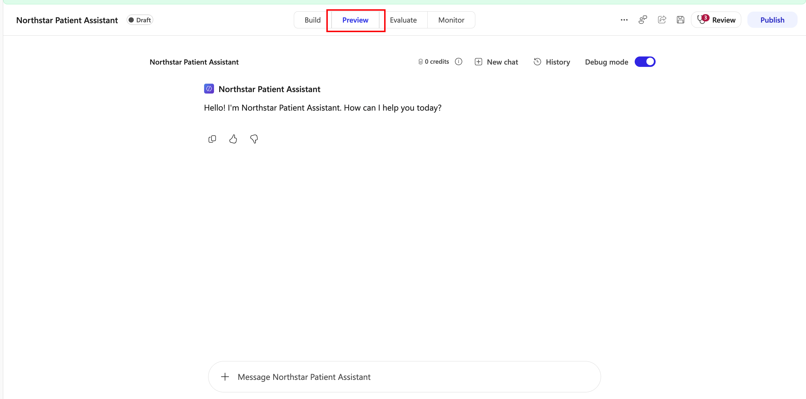

2.  Enter the following prompt and send it: +++I have chest pain.+++  
    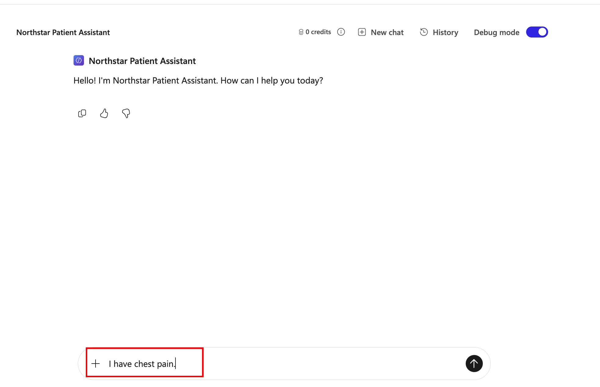

3.  The agent should return the emergency message and nothing else.  
    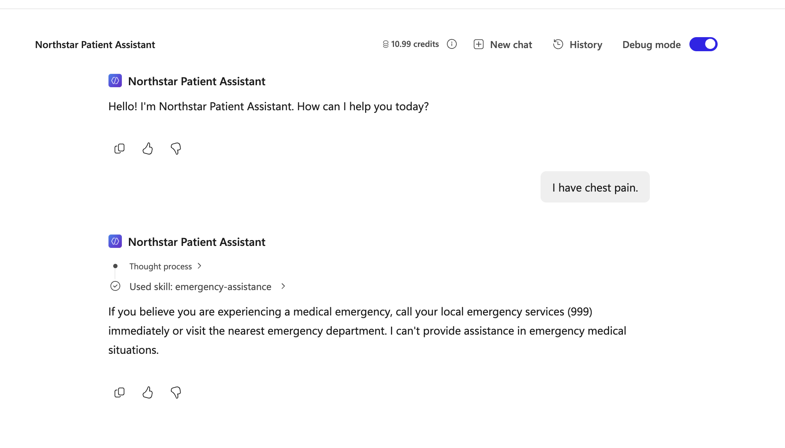

4.  Start a new conversation and enter: +++Which insurance providers do
    you accept?+++  
    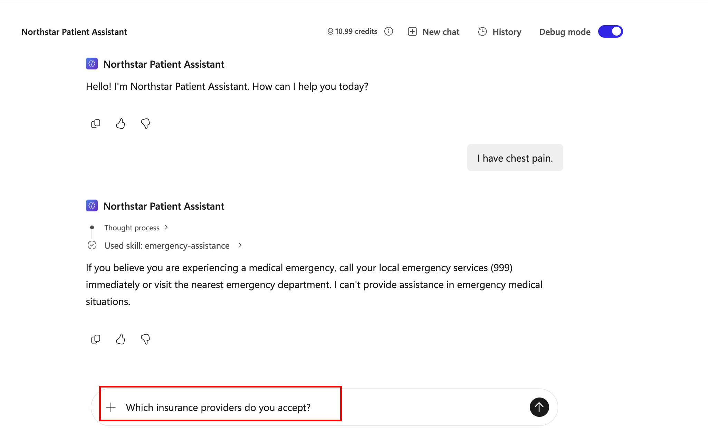

5.  The agent should answer from the hospital information files and end
    with the disclaimer.  
    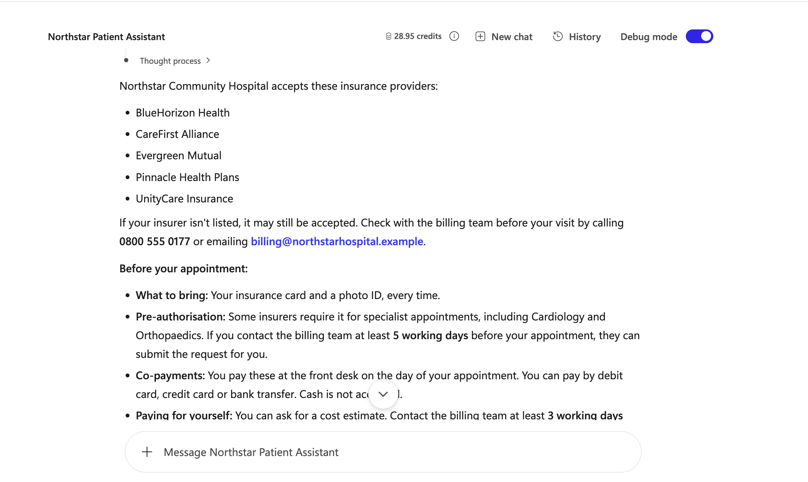

6.  Start a new conversation and enter: +++I want to book an
    appointment.+++  
    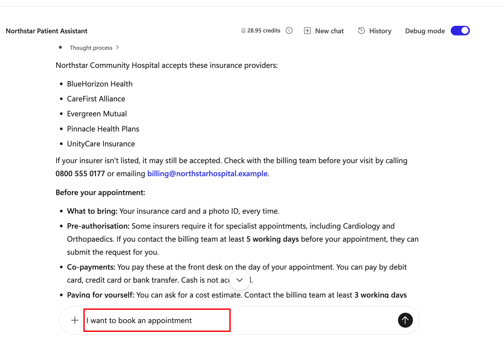

7.  Answer the follow-up questions:

    - **Patient ID:** +++NH2201+++

    - **Date of birth:** +++1985-11-02+++

    - **Full name:** +++James Ortiz+++

    - **Specialty:** +++Cardiology+++

    - **First visit or follow-up:** +++First Visit+++

    - **Reason for appointment:** +++I am feeling a little pain in my
      chest+++

8.  Confirm that the agent shows the medical-advice message and the
    thank-you message.  
    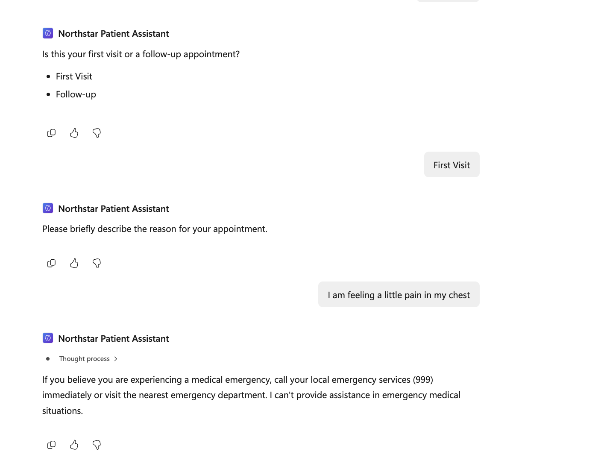

> **Note:** In the new experience the agent reasons about which skill to
> use, so wording can vary slightly between runs. If a skill does not
> activate, make its description more specific and test again.

## Exercise 2: Show Appointment Slots and Confirm Bookings

Add the appointment schedule as a knowledge source, extend the
book-appointment skill to list slots and confirm a booking, and then
publish the agent to Microsoft 365 Copilot.

### Task 1: Add the Appointment Schedule as Knowledge

Give the agent the slot data it needs to show available appointments.

1.  In Copilot Studio, open **Northstar Patient Assistant** and select
    the **Build** tab.  
    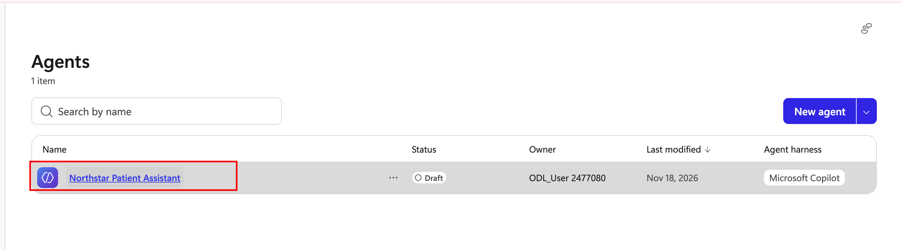

2.  In the components panel, select **Knowledge**.  
    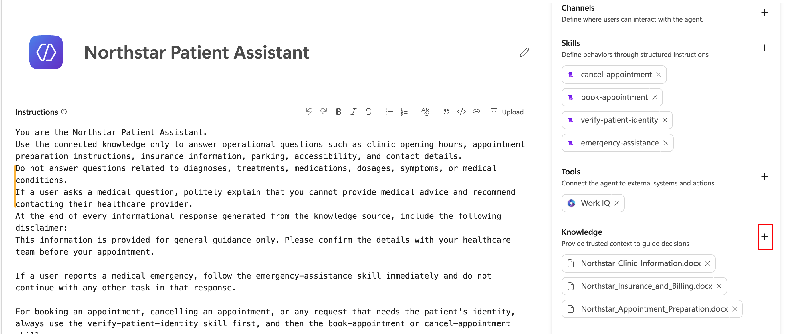

3.  In the **Add knowledge** dialog, drag and drop
    C:/Labfiles/Healthcare/AppointmentSlot.csv onto the upload area, or
    select the area and browse to the file. If the CSV is not accepted
    in your environment, upload AppointmentSlot.xlsx instead.

4.  Select **Add** (or **Save**) to confirm.  
    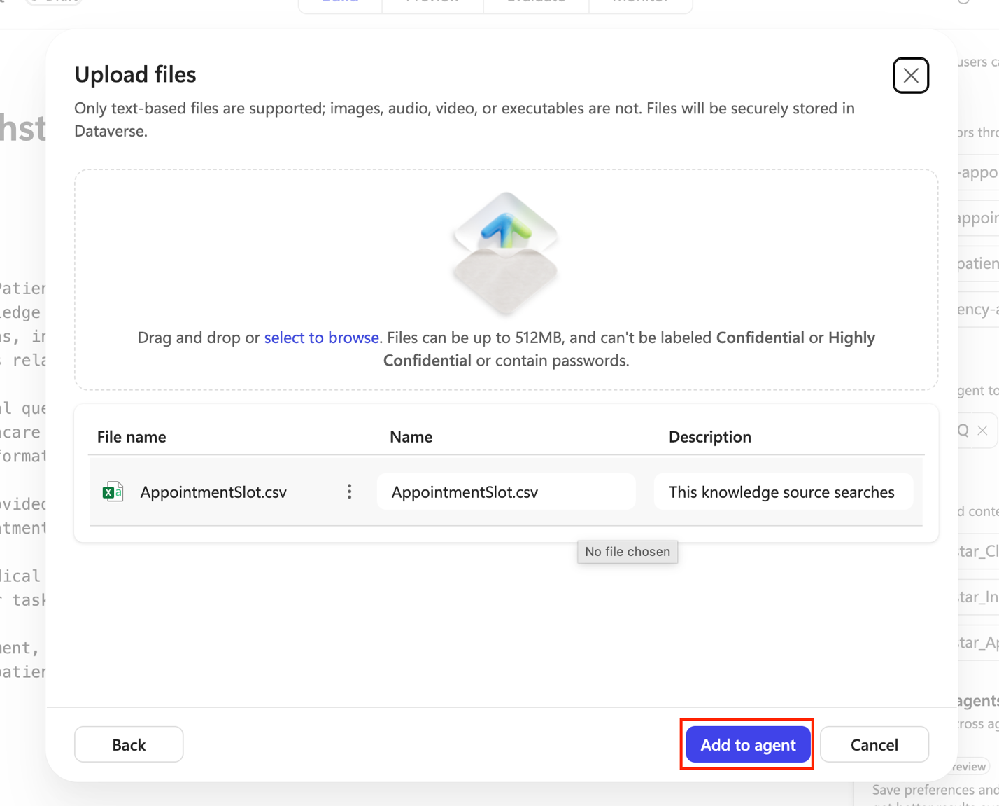

5.  Open the new knowledge source and set the following, so the agent
    can tell when to use it:

    - **Name:** +++Appointment Schedule+++

    - **Description:** +++Appointment slots by specialty, with slot ID,
      date and time, clinician, location and booking status. Use only
      when booking an appointment.+++

6.  Select the space under **Instructions** and move to the end of the
    existing text. Add a new line:

Use the Appointment Schedule knowledge only when booking an appointment.
Never use it to answer general hospital questions.

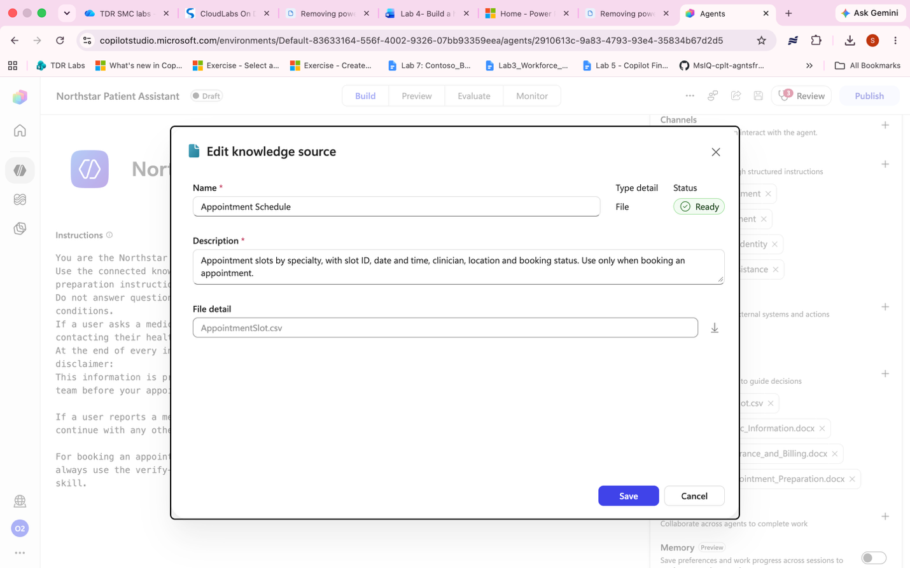

7.  Select **Save**.

> **Note:** The new experience has no general knowledge setting. The
> agent uses only the sources you add, so check each source's name and
> description.

### Task 2: Extend the Book Appointment Skill

Update the skill so the agent lists available slots, asks the patient to
choose one, and confirms the booking.

1.  In the **Build** tab, select **Skills**, and then select
    **book-appointment** to open its configuration panel.  
    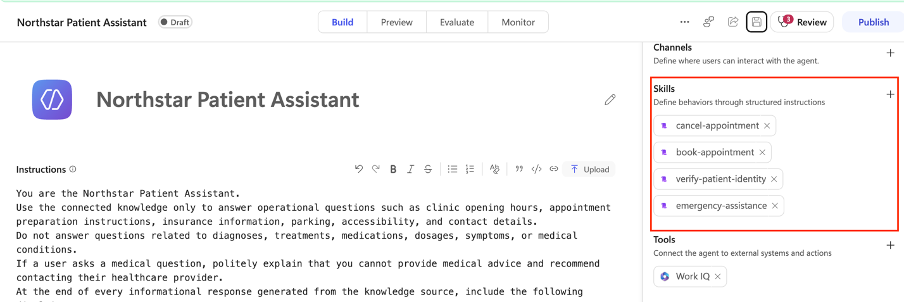

2.  In **Instructions**, delete step 6 ("Say: Thank you. I've collected
    the information...") and add the following steps in its place:

6\. Look up the Appointment Schedule knowledge. Find up to 4 slots for
the patient's specialty whose Doctor Booking Status is Available. Never
invent slots.  
7. Say: "I found the following available appointments:" and then show
each slot on separate lines with Date, Time, Doctor, Location and Slot
ID, with a blank line between slots. If no slots are available, say so
and offer a different specialty.  
8. Ask: "Which appointment would you like to book? Please enter the Slot
ID." Remember the answer as selectedSlot. Accept only a Slot ID from the
list you just showed.  
9. Ask: "Would you like to confirm this booking?" Offer the options Yes
and No.  
10. If the answer is Yes, reply with exactly this format, using the
remembered values:  
✅ Your appointment has been confirmed.  
Appointment Reference: \<selectedSlot\>  
Patient Name: \<PatientName\>  
Specialty: \<specialty\>  
Status: Booked  
11. If the answer is No, say: "No problem. Your appointment has not been
booked. Let me know if you would like to choose a different slot."

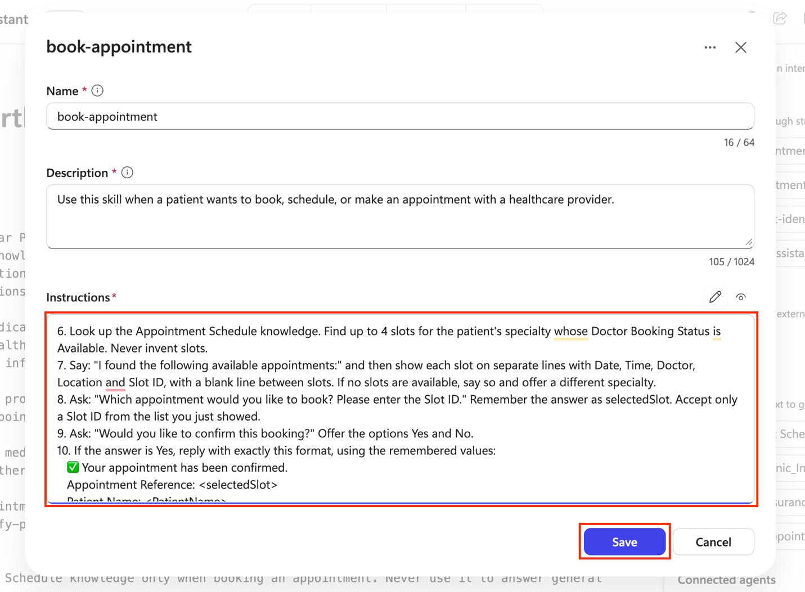

3.  Select **Save**.

> **Note:** This lab simulates the booking. The agent confirms the slot
> in the conversation, but the schedule file is not updated, so the same
> slot can be booked again. A production solution would write the
> booking to a system of record by adding a tool.

### Task 3: Publish the Agent to Microsoft 365 Copilot

Make the Northstar Patient Assistant available inside Microsoft 365
Copilot.

1.  In Copilot Studio, with **Northstar Patient Assistant** open, select
    **Publish** in the upper-right corner.  
    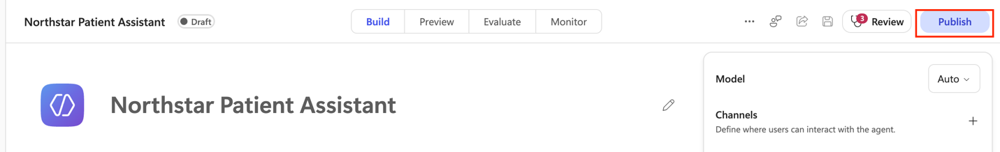

2.  In the **Publish agent** dialog, review the agent details. Select
    the **Teams + Microsoft 365** channel and make sure **Make agent
    available in Microsoft Copilot** is turned on.  
    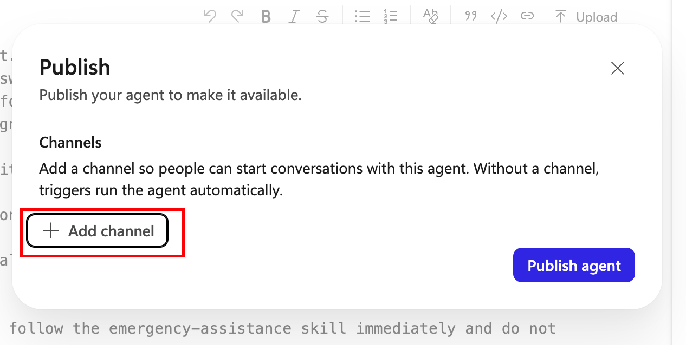  
    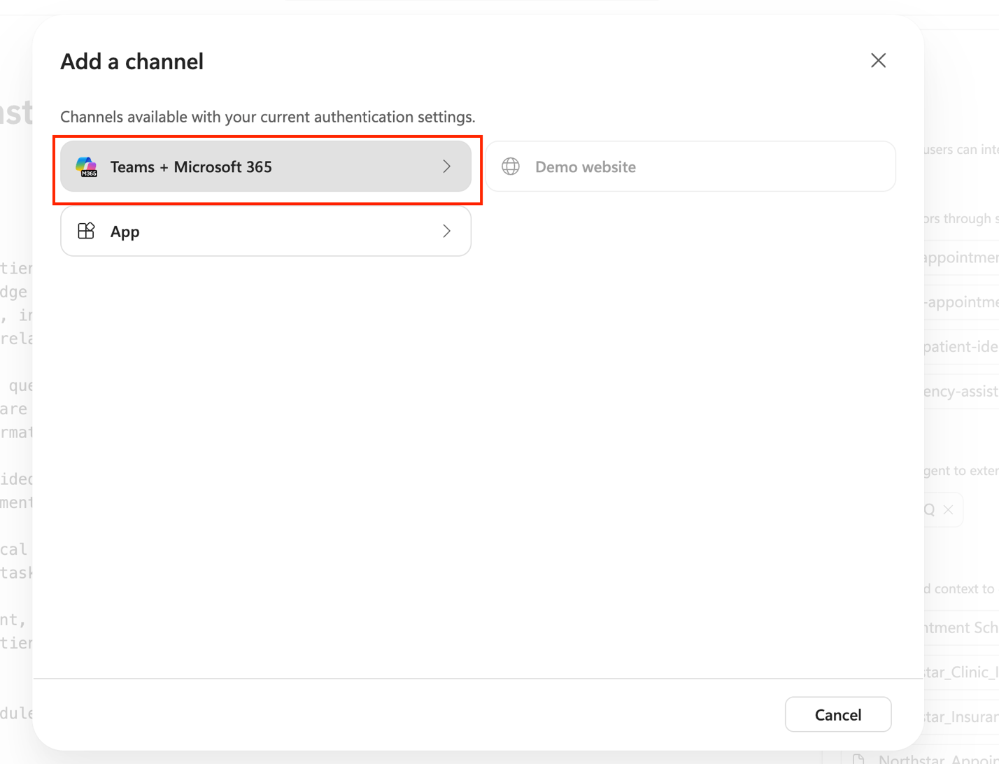  
    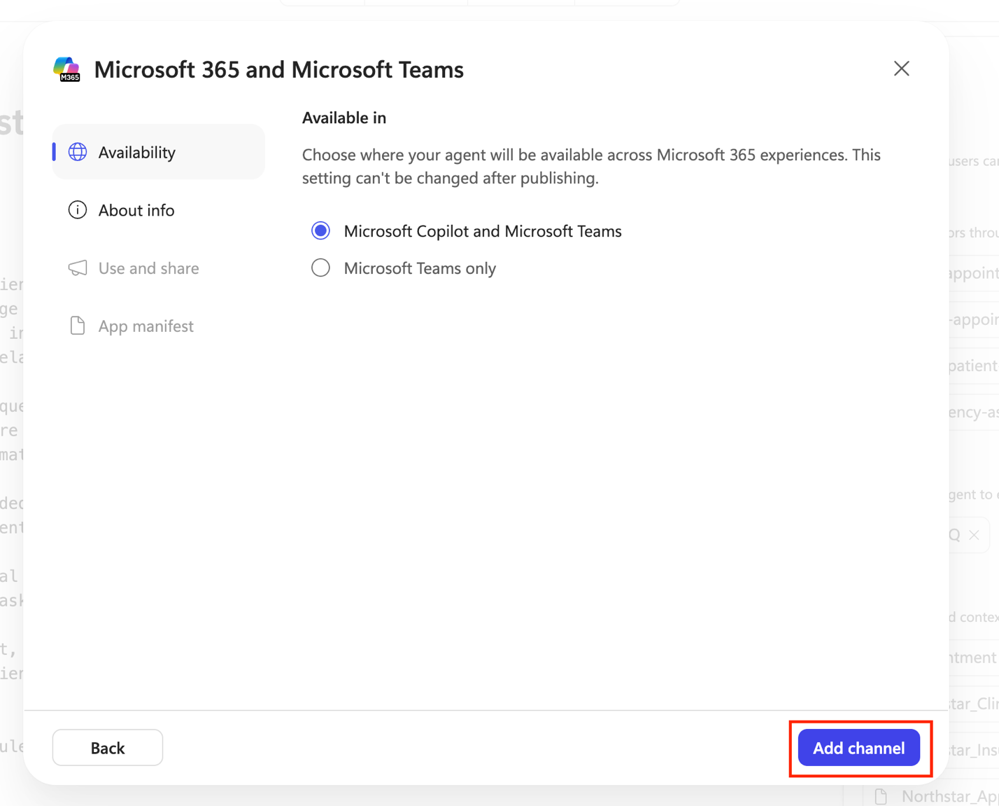

3.  Select **Publish** to confirm, and wait for the dialog to show that
    publishing succeeded.  
    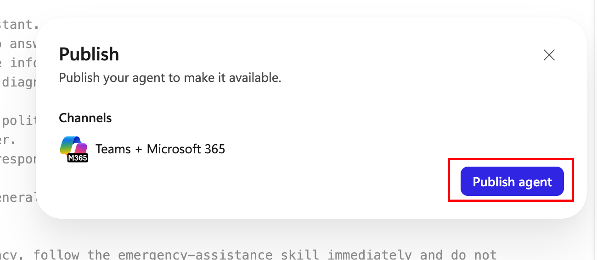

4.  Open Microsoft 365 Copilot at
    +++https://m365.cloud.microsoft/chat+++ in a new browser tab.  
    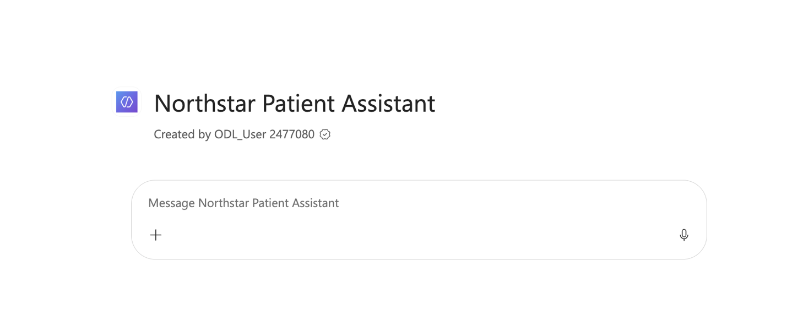

5.  In the left navigation, under **Agents**, select **Northstar Patient
    Assistant**.

> **Note:** To let other people test the agent, select the **Share**
> icon next to **Publish** and add them. Sharing requires the agent's
> authentication to be set to **Authenticate with Microsoft**. In some
> tenants an administrator must approve the agent before it appears in
> Microsoft 365 Copilot. If it is not listed, continue testing in the
> **Preview** tab.

### Task 4: Test the End-to-End Appointment Booking Experience

Validate the complete booking conversation in Microsoft 365 Copilot (or
the **Preview** tab).

1.  With **Northstar Patient Assistant** selected, enter: +++I want to
    book an appointment.+++  
    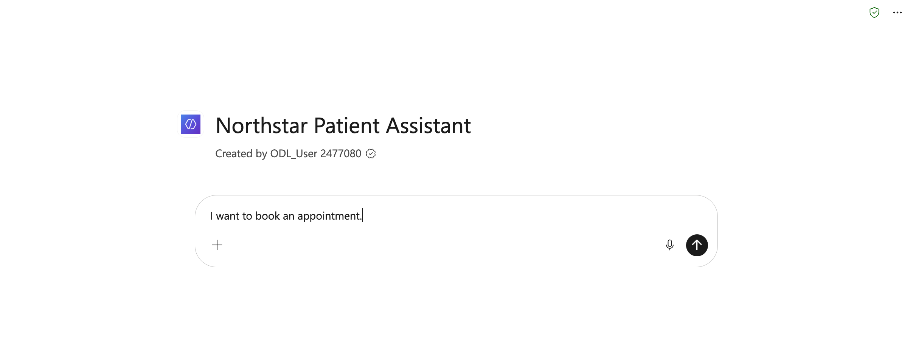

2.  Answer the follow-up questions:

    - **Patient ID:** +++NH2201+++

    - **Date of birth:** +++1985-11-02+++

    - **Full name:** +++James Ortiz+++

    - **Specialty:** +++Orthopaedics+++

    - **First visit or follow-up:** +++First Visit+++

    - **Reason for appointment:** +++I am feeling a little pain in my
      right knee+++

3.  Review the list of available Orthopaedics slots. It should include
    **APT1024**.  
    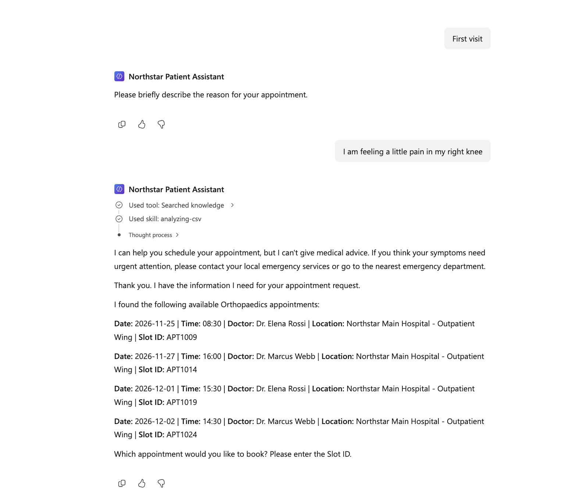

## Lab Summary

In this lab, you built an AI-powered healthcare appointment assistant
using the new Microsoft Copilot Studio experience and Microsoft 365
Copilot. You created a conversational experience that verifies patient
identity, answers hospital-related questions using organizational
knowledge, handles emergency scenarios responsibly, and enables patients
to book or cancel appointments.

You did this without topics: instructions set the always-on guardrails,
skills defined each task, and an uploaded schedule gave the agent the
slots to offer. You then published the agent to Microsoft 365 Copilot
and validated the end-to-end experience. Booking and cancellation are
simulated in this version; connecting the agent to a system of record
with a tool is a natural next step for a production scenario.
