# Lab 5: **Extend Microsoft 365 Copilot Chat with a HR Agent built using Microsoft Copilot Studio**
**Duration:** 30 minutes

# Objective & Scenario

In this lab, you explore how Microsoft 365 Copilot enhances the daily workflow of finance professionals by embedding AI assistance directly into Excel, Teams, and Copilot Chat. Acting as a Financial Analyst at Zava Retail, you use Copilot to analyze product cost data, summarize and organize finance meeting outcomes, generate follow-up task lists, and evaluate a potential acquisition through structured financial and operational analysis. You also apply Copilot Studio harness-selection criteria to decide which agent harness best fits three finance scenarios. The lab demonstrates how Copilot accelerates data interpretation, improves collaboration, transforms meeting content into actionable tasks, and helps produce strategic reports that support faster, better-informed business decisions.

Through these guided scenarios, you experience how Copilot can reduce manual effort, improve accuracy, and turn complex financial information into clear, decision-ready insights for leadership.

## Key Personas in This Lab

- **Financial Analyst (You):** Leads data analysis, reporting, and strategic financial evaluation.

- **Robin Kline – Finance Manager:** Provides business context, priorities, and decision-making direction.

- **Amari Rivera – Finance Team Member:** Contributes operational finance inputs and action items.

- **Quincy Brooks – Finance Team Member:** Supports financial planning and task execution.

- **Miguel Reyes – Finance Team Member:** Assists with analysis and cross-functional finance coordination.

- **Eric Solomon – Finance Team Member:** Contributes to compliance, reporting, and follow-up actions.

- **Executive Leadership Team:** Reviews insights generated from Copilot outputs to guide strategic decisions on product launch and acquisition planning.

# Exercise 1: Use Copilot in Excel to Analyze New Product Line COGS

The Finance team is finalizing Cost of Goods Sold (COGS) estimates for Zava Retail's new Zava Home product line. As the team's lead financial analyst, you are tasked with verifying the latest COGS data provided by the Merchandising team and ensuring leadership can easily review the most relevant numbers.

**Complete the following steps in order:**

1.  Navigate to +++https://onedrive.live.com/login+++. Log in with your credentials.

2.  Select the link to download the file +++Zava Home COGS Estimates.xlsx+++ file and store it in your OneDrive account.

> 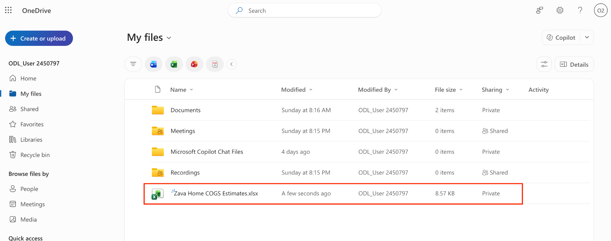

3.  Open the Excel sheet and select the **Copilot** from bottom right corner.  
    > 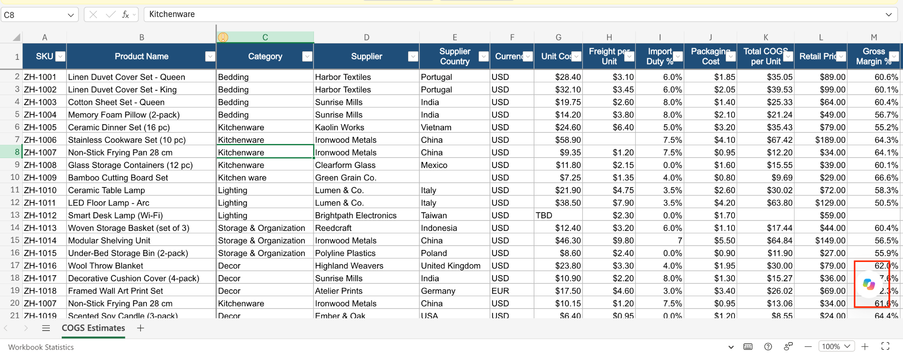

4.  To analyze the dataset, paste the prompt below and select the **Execute** button:

| +++I'm a financial analyst for Zava Retail. I was asked to analyze the Zava Home COGS Estimates spreadsheet for Zava Retail's new Zava Home product line. Can you please review the dataset in this spreadsheet and provide two things in a new sheet: (1) a clear description of each key column and its purpose, and (2) a list of any missing or inconsistent data points that could affect accuracy. Present your findings in a concise, structured format in a new sheet.+++ |
|-----------------------------------------------------------------------------------------------------------------------------------------------------------------------------------------------------------------------------------------------------------------------------------------------------------------------------------------------------------------------------------------------------------------------------------------------------------------------------------|

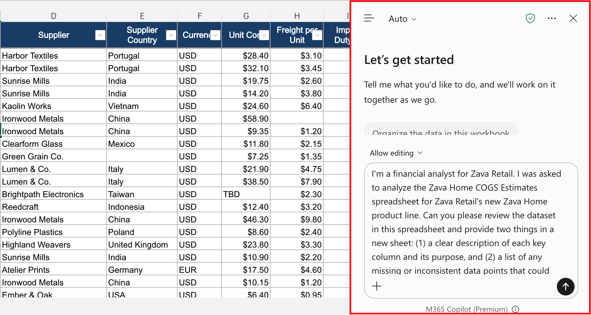

5.  **Review the output.**

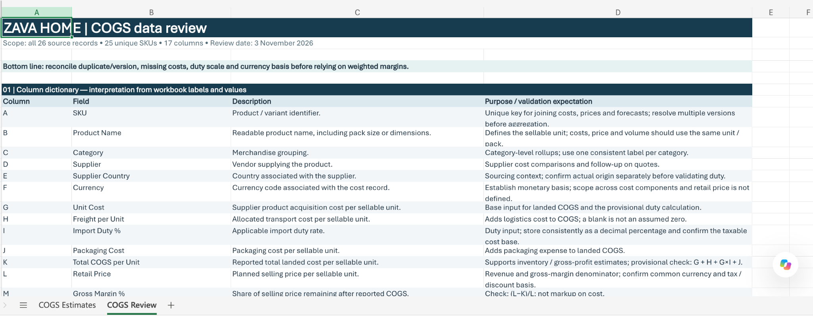

# Exercise 2: Use Copilot in Teams to Summarize Meeting Notes

In your role as a Financial Analyst for Zava Retail, you joined a meeting with Robin Kline, Zava Retail's Finance Manager, and other Finance department members including Amari Rivera, Quincy Brooks, Miguel Reyes, and Eric Solomon. You didn't have time to take detailed notes, so you turned to Copilot for help.

## Task 1: Summarize Meeting Notes

1.  Select the link to download the file +++Zava Retail Finance meeting notes.txt +++ file and store it in your OneDrive account.  
    > 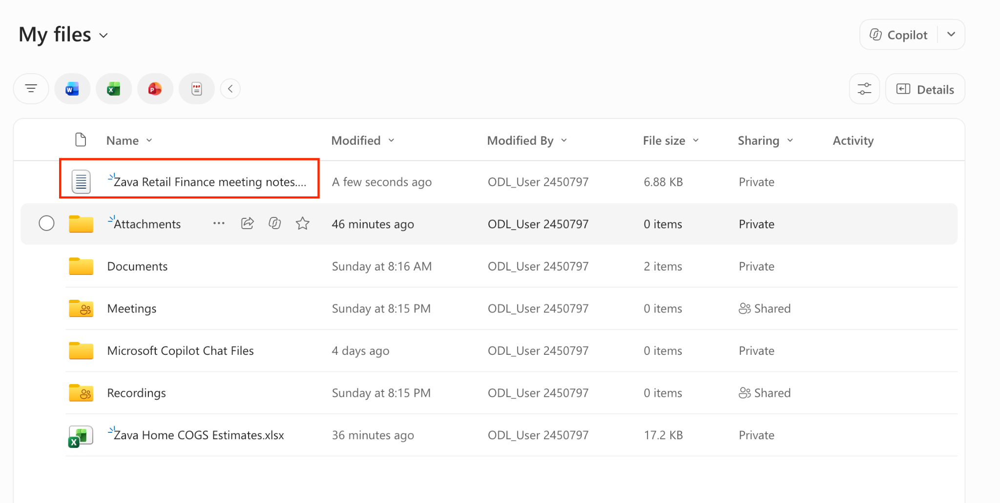

2.  Then, navigate to +++ Microsoft 365 home page +++ and select **Teams** from the **Apps** section in the navigation pane.  
    > 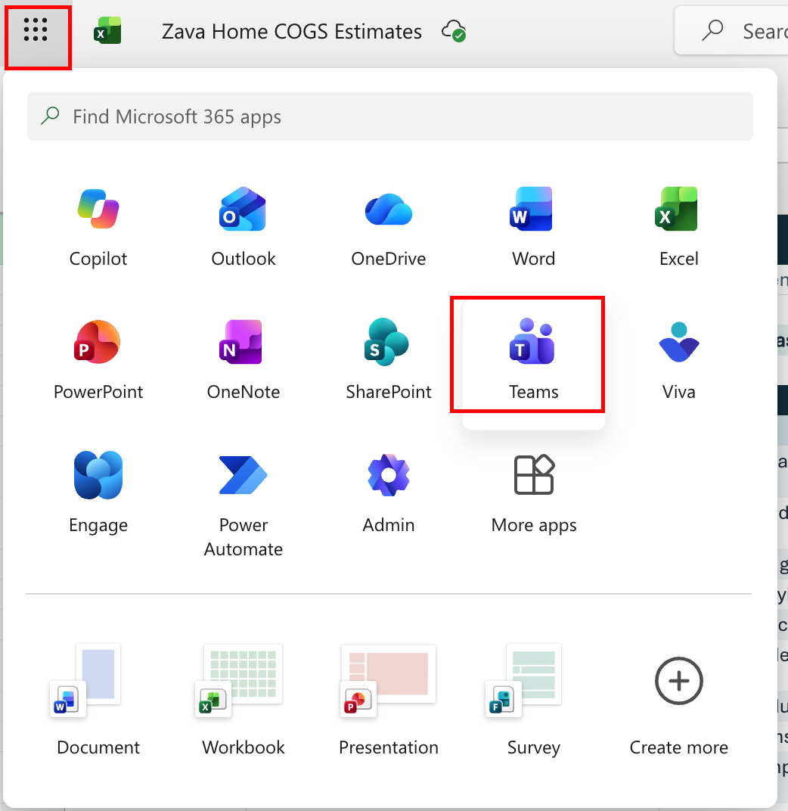

3.  Open the Copilot Chat. In Teams for the web, select **Copilot** in the navigation pane.

> 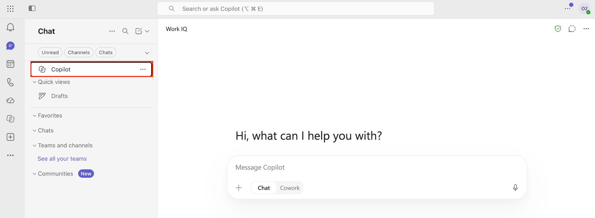

4.  In the Copilot description box, paste the following prompt and select the **Execute** button:

| +++Generate a downloadable summary. Review the summary to ensure it includes decisions, next steps, and responsibilities. Ask Copilot to generate a downloadable file for distribution to the meeting participants. Download the document that Copilot generated.+++ |
|----------------------------------------------------------------------------------------------------------------------------------------------------------------------------------------------------------------------------------------------------------------------|

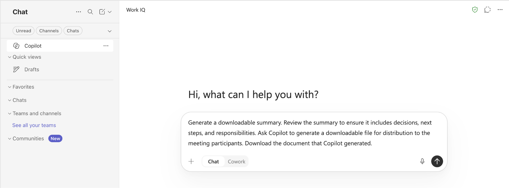

5.  **Review the output.**

> 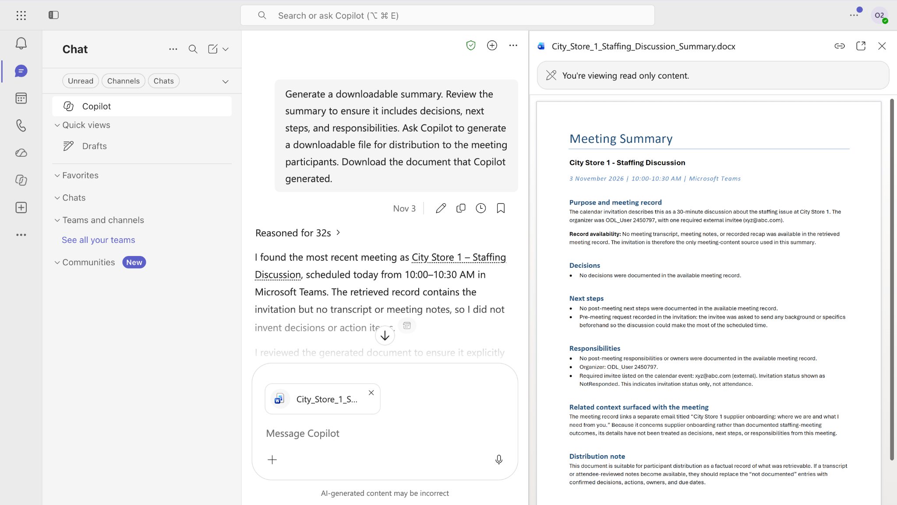

## Task 2: Creating a Task List

After reviewing the next steps in the report summary, ask Copilot to generate a detailed task list for each participant based on the action items in the notes.

1.  To generate a task list, paste this prompt in the description box and select the **Execute** icon:

| +++Based on the action items and next steps in the meeting summary, create a detailed task list for each participant. Assign responsibilities clearly and include suggested deadlines or priority levels for each task, such as high, medium, or low priority where appropriate+++ |
|------------------------------------------------------------------------------------------------------------------------------------------------------------------------------------------------------------------------------------------------------------------------------------|

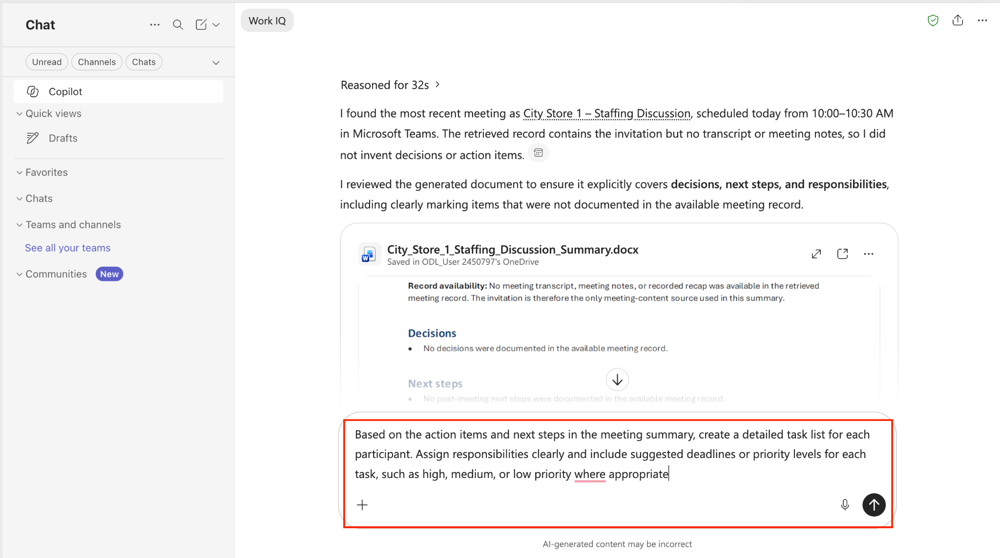

2.  **Review the output.**

# Exercise 3: Use Copilot Chat to Analyze a Potential Acquisition

Zava Retail's executive team is evaluating the potential acquisition of Relecloud, Ltd. Robin Kline, Zava Retail's Finance Manager, sent you a detailed business perspective for Relecloud that provides an overview of the company's market position, financial performance, customer and sales insights, operations and capabilities, intellectual property, product roadmap, risks and challenges, and future outlook.

This task demonstrates how Copilot Chat can extract, categorize, and structure complex financial information into actionable summaries — and how detailed prompts consistently produce more satisfactory results than high-level, vague ones.

## Task 1: Create a business perspective summary

1.  Select the link to download the **Relecloud Business Perspective.docx** file and store it in your OneDrive account.  
    > 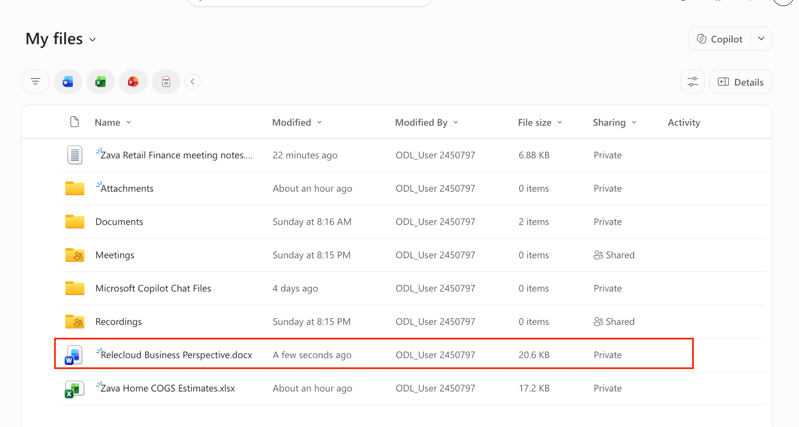

2.  Go to https://m365.cloud.microsoft/chat.com and select **Work IQ** mode.  
    > 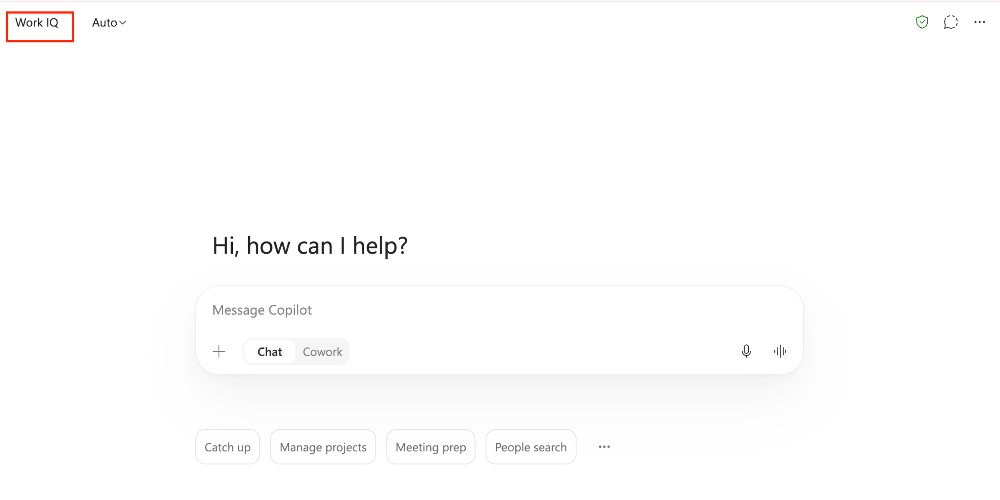

3.  In the Copilot prompt field, attach the **Relecloud Business Perspective.docx** file. Paste the following prompt and select the **Execute** button:

| +++Review the attached Relecloud Business Perspective document and create a business perspective summary with the following three sections: (1) Relecloud’s financial data, (2) Operations analysis of Relecloud, and (3) Integration plan for the acquisition. Present the summary in a clear and structured executive format suitable for leadership review.+++ |
|-------------------------------------------------------------------------------------------------------------------------------------------------------------------------------------------------------------------------------------------------------------------------------------------------------------------------------------------------------------------|

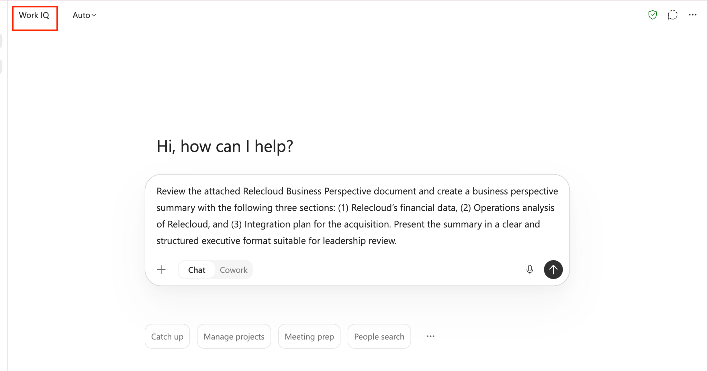

4.  **Review the output.**

> 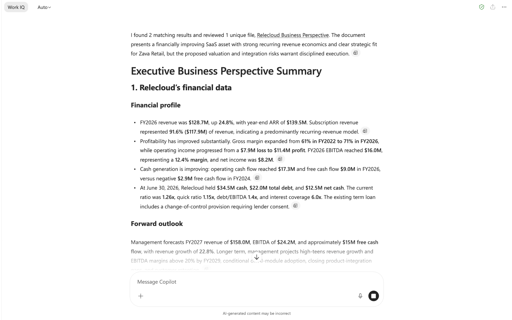

## Task 2: Expand the Summary and generate a comprehensive report

After reviewing the initial summary, ask Copilot to generate a more comprehensive version of the report with deeper analysis and visuals.

1.  In the Copilot prompt field, paste the following prompt and select the **Execute** button:

<table>
<colgroup>
<col style="width: 100%" />
</colgroup>
<thead>
<tr class="header">
<th>
+++Expand the previous Relecloud acquisition report and include all prior information, plus the following additional analysis:

Financial Analysis Section: 
Valuation and deal structure, including valuation multiples and deal structure implications 
Financial health and ratios, including liquidity, solvency, profitability trends, gross-to-net retention by cohort, regional ARR dynamics, and cash flow analysis 
Revenue and customer concentration, including revenue breakdown, concentration risks by customer and sector, churn drivers, and retention trends 
Include line or bar charts showing revenue, EBITDA, net income, gross margin, and operating margin trends over time

Operations Analysis Section: 
Cost structure and efficiency, including COGS, OpEx, efficiency metrics, and scalability assessment 
Competitive positioning, including SWOT analysis and peer benchmarking 
Include a SWOT Matrix visual summarizing strengths, weaknesses, opportunities, and threats 
Include a Scalability Assessment Diagram illustrating DevSecOps maturity, infrastructure readiness, and organizational scalability.

Integration Planning Section: 
Synergy and integration modeling, including synergy realization opportunities, integration risks, and post-merger integration planning 
Leadership and organizational review, including management track record and organizational structure assessment 
Include an Integration Timeline (Gantt Chart) showing phases and milestones for post-merger integration

Format the report as a detailed executive acquisition analysis suitable for finance leadership decision-making.+++
</th>
</tr>
</thead>
<tbody>
</tbody>
</table>

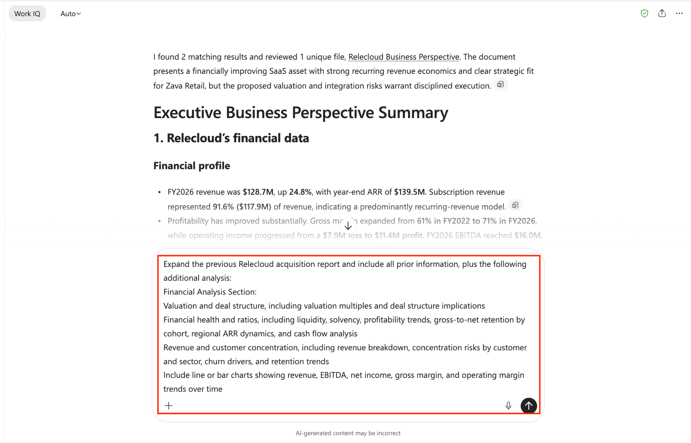

2.  **Review the output.  
    > **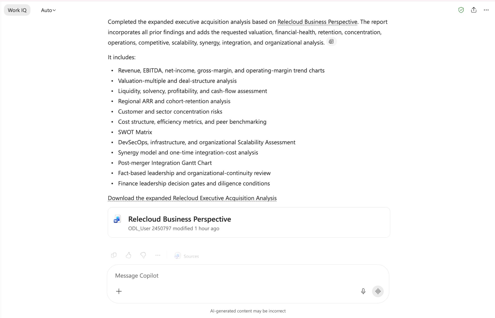

# Exercise 4: Select the Right Agent Harness for Finance Scenarios

**Duration:** about 5 minutes. No Copilot Studio environment is required.

The Finance team wants to build agents in Copilot Studio. Each agent runs on one harness, and the right choice depends on how much control the team needs and how much the agent must plan on its own. For each scenario below, read the requirement and decide which harness fits best: **Standard**, **GitHub Copilot**, or **Copilot Chat**.

## Scenario 1: Acquisition due diligence

Robin Kline wants an agent that receives target-company files such as contracts, financial statements, and customer lists. It should extract key terms, compare them with Zava Retail's acquisition criteria, check them against internal vendor and customer records, and route exceptions to Robin for review. The steps change depending on what each file contains and what the tools return.

## Scenario 2: Purchase order exception request

The Finance team wants an agent that always collects the purchase order number, validates the requester's cost centre, and presents the correct approval options. It must follow explicit branches for orders above and below the approval threshold. The team wants makers to control every question and path.

## Scenario 3: Finance policy questions

Employees want to ask Microsoft Copilot Chat about travel and expense policies. Answers must only use SharePoint content that each employee has permission to access. The team doesn't need an external channel or a long-running business process.

### Record your decisions

| **Scenario**                  | **Your harness choice** | **Key requirement that drove your choice** |
|-------------------------------|-------------------------|--------------------------------------------|
| 1\. Acquisition due diligence |                         |                                            |
| 2\. Purchase order exception  |                         |                                            |
| 3\. Finance policy questions  |                         |                                            |

### Review your decisions

| **Scenario**                  | **Recommended harness**    | **Why**                                                                                                                                |
|-------------------------------|----------------------------|----------------------------------------------------------------------------------------------------------------------------------------|
| 1\. Acquisition due diligence | **GitHub Copilot** harness | File-intensive, reasoning-heavy work across several tools. The agent must adapt its plan to intermediate results and route exceptions. |
| 2\. Purchase order exception  | **Standard** harness       | Needs a structured, predictable conversation with maker-defined questions, conditions, and branches.                                   |
| 3\. Finance policy questions  | **Copilot Chat** harness   | The main need is to extend Microsoft Copilot Chat with permission-aware enterprise knowledge for internal users.                       |

<table>
<colgroup>
<col style="width: 100%" />
</colgroup>
<thead>
<tr class="header">
<th>
<strong>[!Alert]</strong>

When a requirement mixes elements from more than one scenario, identify the dominant job and the control model it needs. A solution can combine agents and workflows, but each agent still runs on one selected harness.
</th>
</tr>
</thead>
<tbody>
</tbody>
</table>

# Lab Summary

In this lab, you worked as a Financial Analyst at Zava Retail and used Microsoft 365 Copilot across Excel, Teams, and Copilot Chat to support major business initiatives. In Excel, you analyzed COGS data for the Zava Home product line to identify cost drivers, outliers, and insights for leadership review. In Teams, you summarized finance meeting notes and generated participant-specific task lists. In Copilot Chat, you developed a detailed acquisition analysis of Relecloud, progressing from an initial summary to a comprehensive financial report with visuals and integration planning. Finally, you applied harness-selection criteria to three finance scenarios, matching each requirement to the Standard, GitHub Copilot, or Copilot Chat harness in Copilot Studio. Throughout the lab, you also strengthened your prompt-writing skills by applying clear goals, context, sources, and expectations to produce more accurate and effective Copilot outputs.
